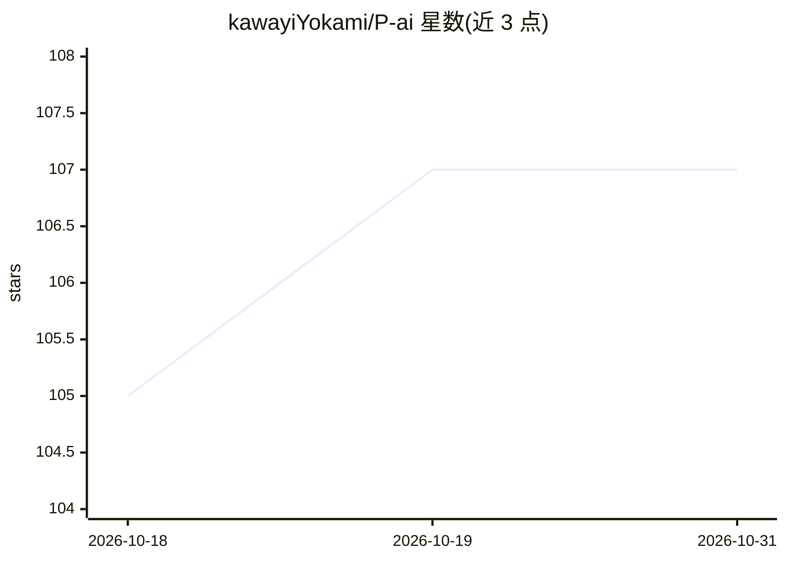

# kawayiYokami/P-ai

⭐ 107 · Rust · GPL-3.0 · 推送 2026-10-27 · [GitHub](https://github.com/kawayiYokami/P-ai) · [官网](https://github.com/kawayiYokami/P-ai) · 个人维护 · 中文 README

**开箱即用的桌面 AI 助理：长期任务、记忆与高并发工作区自动化**

基于 Tauri 2 + Rust + Vue 3 的桌面 AI 工作系统，围绕会话、任务、记忆、人格组织、工具与审查构建，定位为非聊天客户端的完整桌面系统。功能包括全局热键召唤、语音唤醒、多会话并行、多人格父子组织、远程会话（微信/飞书/钉钉/OneBot）、长对话压缩归档记忆、LLM 执行操作脚本控制电脑、MCP 与技能自主管理、工具执行审查链。数据全部本地存储，API key 不经中转服务器。提供 Windows/Linux/macOS 安装包与便携版。

## 筛选速览

| 维度 | 判定 | 备注 |
|---|---|---|
| AI 角色 | `ai-native` | 本体是模型或模型工具 |
| 许可风险 | `viral` | GPL-3.0 |
| 部署形态 | `None` |  |
| 模型依赖 | — | README 未给出锁定关系 |
| 硬件要求 | — | 无带数字的原话,不猜 |
| 安装摩擦 | `low` | 无编译、无系统依赖或容器化 |
| 成熟度 | — | 结构信号不足 |

## 能力要点

- LLM 可执行操作脚本控制电脑，支持 MCP/技能/人格自主管理
- 长对话动态压缩归档，会话可持续保持上下文
- 远程会话支持微信、飞书、钉钉、OneBot 等协议
- 工具执行与代码变更多角度 AI 审查，工具修改可回滚

## 适用场景

- 长期运行编程、爬虫、论文分析等持续性任务
- 通过微信等远程渠道让 AI 持续产出内容或监控信息
- 本地数据全自管、可从 U 盘便携运行

## 场景标签

`AI 助手` `GUI 自动化` `编码 Agent` `网页抓取` · 领域:效率与自动化

## 证据(README 行号)

> L12: > **A self-growing desktop AI work system — ready-to-use, with agent delegation, long-term memory, tool review, MCP
> L14: PAI is an actively evolving desktop AI work system. It is not a chat client — it is a complete desktop system organ

## 星数曲线

2026-10-18 105 → 2026-10-31 107（+2）

---
*卡片 v1 · prompt 1.4 · 生成 2026-10-23 · 置信度 high · 依据 README sha `0571df93dab0` · [字段定义](../../DATASET.md)*
