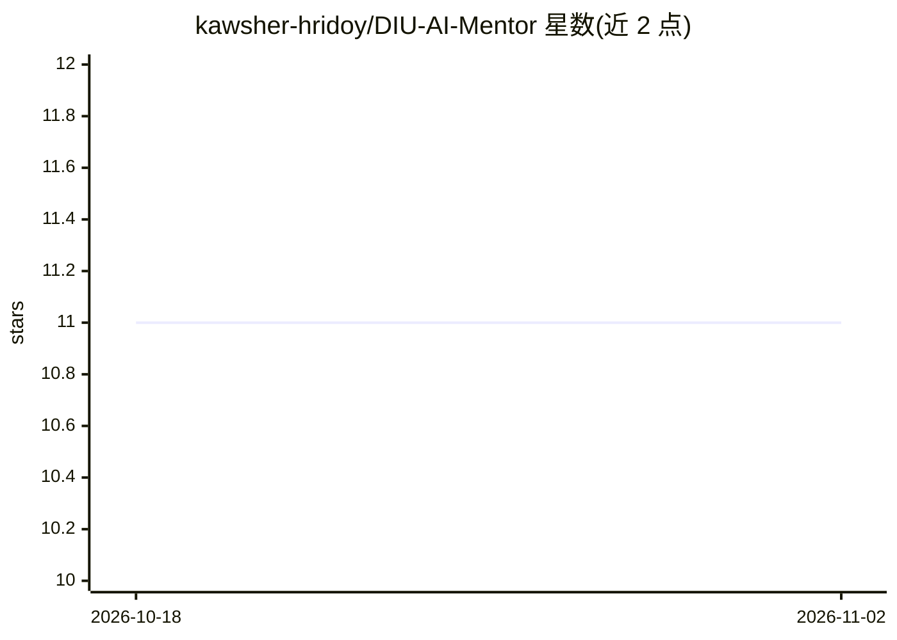

# kawsher-hridoy/DIU-AI-Mentor

⭐ 11 · Python · 推送 2026-07-11 · [GitHub](https://github.com/kawsher-hridoy/DIU-AI-Mentor) · 组织维护

**大学导师的 AI 风险排序指挥中心：确定性评分+LLM 叙述**

面向负责 50+ 学生的大学导师的网页应用：读取现有导师门户 API（只读），用 8 项加权信号的确定性引擎为每位学生计算 0–100 风险分并分层排序，评分可逐项分解；LLM 层（Azure OpenAI 或内置离线 mock）只负责把已算好的数字转成自然语言——每日简报、学生摘要、会议准备与基于存储数据的问答，模型不影响评分。发送给 LLM 前以占位符替换姓名与学号。技术栈为 FastAPI + SQLAlchemy + Next.js 14，自带 50 名合成学生的预置数据库，默认完全离线运行。

## 筛选速览

| 维度 | 判定 | 备注 |
|---|---|---|
| AI 角色 | `ai-native` | 本体是模型或模型工具 |
| 许可风险 | `none` | — |
| 部署形态 | `library` | 以包/库形式分发 |
| 模型依赖 | — | README 未给出锁定关系 |
| 硬件要求 | — | 无带数字的原话,不猜 |
| 安装摩擦 | `low` | 无编译、无系统依赖或容器化 |
| 成熟度 | — | 结构信号不足 |

## 能力要点

- 8 信号确定性风险引擎（纯函数、14 个单元测试、贡献分解总和恒等于评分）
- LLM 仅叙述不评分：每日简报、学生摘要、会议准备、有据问答
- 隐私设计：姓名与学号在送入 LLM 前替换为占位符
- AI_PROVIDER=mock 默认离线运行，无需 API key

## 适用场景

- 导师每天登录即看到谁最需要关注及原因
- 为个别学生生成诊断摘要与会议议程/建议问题
- 会后把两行粗略笔记扩展为结构化会议记录

## 场景标签

`数据分析` · 领域:效率与自动化

## 证据(README 行号)

> L29: 1. **A deterministic risk engine ranks** — every student gets a 0–100 risk
> L33: 2. **An LLM narrates** — Azure OpenAI (or a built-in offline mock) turns the

## 星数曲线

2026-10-18 11 → 2026-11-02 11（+0）

---
*卡片 v1 · prompt 1.4 · 生成 2026-11-02 · 置信度 mid · 依据 README sha `2be43ebcafc1` · [字段定义](../../DATASET.md)*
