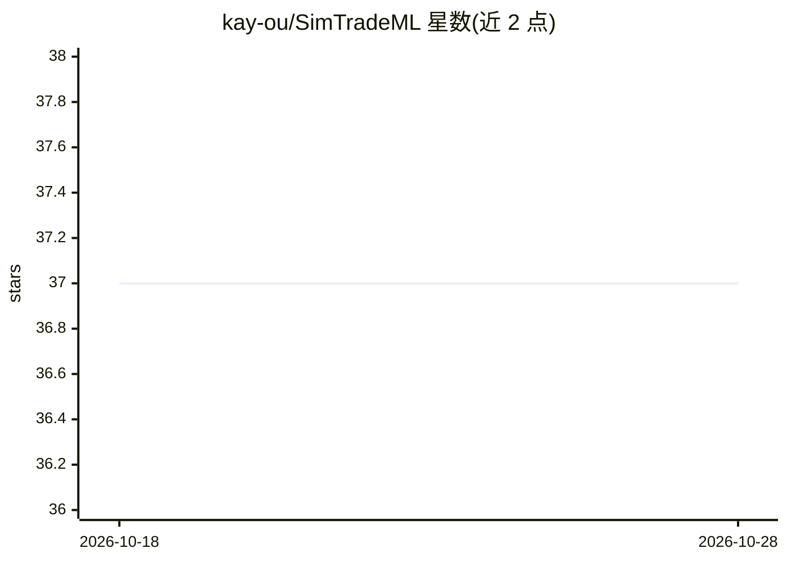

# kay-ou/SimTradeML

⭐ 37 · Python · AGPL-3.0 · 推送 2026-03-19 · [GitHub](https://github.com/kay-ou/SimTradeML) · 个人维护 · 中文 README

**面向 PTrade 量化交易的 ML 训练框架，输出可直接上线的模型**

SimTrade 生态的机器学习训练工具链：读取金融时序数据，进行特征工程与 XGBoost 0.90 训练，输出兼容 PTrade 实盘与 SimTradeLab 回测的模型文件（JSON/Pickle/原生格式）。提供 IC/ICIR/分位收益/方向准确率等量化评估指标，防止未来数据泄漏，支持多进程并行采样。限制：XGBoost 版本锁定 0.90 以保证 PTrade 兼容；当前 v0.2.0 为 MVP 阶段，模型元数据系统等在 v0.3.0 规划中。

## 筛选速览

| 维度 | 判定 | 备注 |
|---|---|---|
| AI 角色 | `ai-native` | 本体是模型或模型工具 |
| 许可风险 | `viral` | AGPL-3.0 |
| 部署形态 | `library` | 以包/库形式分发 |
| 模型依赖 | — | README 未给出锁定关系 |
| 硬件要求 | — | 无带数字的原话,不猜 |
| 安装摩擦 | `low` | 无编译、无系统依赖或容器化 |
| 成熟度 | `idea` | |

## 能力要点

- 训练 XGBoost 0.90 模型并导出 PTrade 兼容格式（JSON/Pickle/原生）
- IC/ICIR/分位收益/方向准确率等量化评估指标
- 防止未来数据泄漏的时序处理与多进程并行加速
- 可继承 DataSource 基类扩展自定义数据源

## 适用场景

- 训练 A 股预测模型并导出到 PTrade 实盘使用
- 在 SimTradeLab 中用同一模型做回测验证
- 量化研究中评估因子预测能力（IC/ICIR）

## 场景标签

`金融量化` `模型训练` · 领域:学习与行业

## 证据(README 行号)

> L5: **PTrade-compatible quantitative trading ML framework** - helps users quickly train prediction models for use in Sim
> L10: - 🎯 **Optimized for PTrade**: Trained models can be used directly in SimTradeLab backtesting and PTrade live tradin
> L139: **Core**: Python 3.9+, numpy, pandas, scikit-learn, **xgboost 0.90** (PTrade compatible version)

## 星数曲线

2026-10-18 37 → 2026-10-28 37（+0）

---
*卡片 v1 · prompt 1.4 · 生成 2026-10-25 · 置信度 mid · 依据 README sha `a362828afdf1` · [字段定义](../../DATASET.md)*
