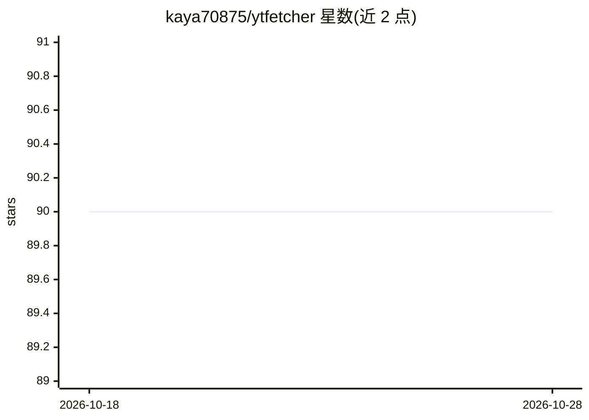

# kaya70875/ytfetcher

⭐ 91 · Python · NOASSERTION · 推送 2026-07-04 · [GitHub](https://github.com/kaya70875/ytfetcher) · [官网](https://kaya70875.github.io/ytfetcher/) · 个人维护

**批量抓取 YouTube 字幕、评论与元数据并导出结构化数据集的 Python 工具**

面向 NLP/ML/RAG 工作流的数据获取库：从频道、播放列表、视频 ID 或搜索词批量抓取字幕、评论与元数据（标题、描述、缩略图、发布日期），支持并发抓取、元数据前置过滤（时长/播放量/标题）、SQLite 转录缓存、代理配置与失败重试，结果可导出为 CSV/TXT/JSON，并可将转录片段拼接为行式结构以配合 Pandas、HuggingFace datasets、Parquet 使用。以 PyPI 包安装，同时提供 CLI 命令。

## 筛选速览

| 维度 | 判定 | 备注 |
|---|---|---|
| AI 角色 | `ai-ecosystem` | LLM/agent 周边工具 |
| 许可风险 | `permissive` | NOASSERTION |
| 部署形态 | `self-host` | docker 或自建部署 |
| 模型依赖 | — | README 未给出锁定关系 |
| 硬件要求 | — | 无带数字的原话,不猜 |
| 安装摩擦 | `low` | 无编译、无系统依赖或容器化 |
| 成熟度 | — | 结构信号不足 |

## 能力要点

- 四种抓取入口：频道、播放列表、视频 ID 列表、搜索词
- 并发抓取与 SQLite 转录缓存（默认开启，支持 TTL 与清理）
- 抓取前按时长/播放量/标题过滤视频元数据
- 结果导出 CSV/TXT/JSON，并可转为行式结构对接 Pandas/HuggingFace datasets

## 适用场景

- 为 NLP/ML 训练或 RAG 语料库批量构建 YouTube 字幕数据集
- 按搜索词或播放列表定向收集视频转录与评论
- 抓取后按元数据条件过滤，减少处理量

## 场景标签

`网页抓取` · 领域:效率与自动化

## 证据(README 行号)

> L8: > ⚡ Build structured YouTube datasets for NLP, ML, sentiment analysis & RAG in minutes.
> L227: If you want a flat, row-based structure for ML workflows (Pandas, HuggingFace datasets, JSON/Parquet), you can use

## 星数曲线

2026-10-18 90 → 2026-10-28 90（+0）

---
*卡片 v1 · prompt 1.4 · 生成 2026-10-23 · 置信度 high · 依据 README sha `aa0899b50291` · [字段定义](../../DATASET.md)*
