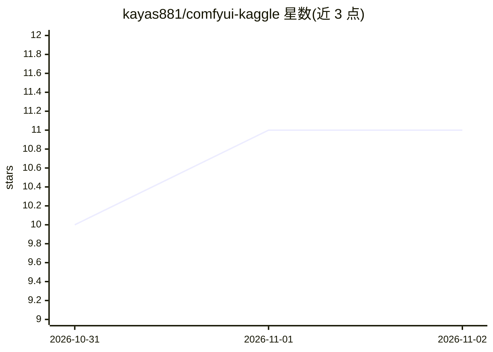

# kayas881/comfyui-kaggle

⭐ 11 · Jupyter Notebook · 推送 2025-12-29 · [GitHub](https://github.com/kayas881/comfyui-kaggle) · 个人维护

**在 Kaggle 免费 GPU 上运行 ComfyUI 工作流的 notebook 模板**

供 Kaggle 平台使用的 notebook：自动安装 ComfyUI 及 Manager，将 models/input/output 目录软链接到 /tmp 以利用约 73GB 磁盘空间，通过 Pinggy 隧道生成公开 URL 供浏览器访问界面。默认预配置 Wan 2.1 模型示例，用户可修改 Cell 4 的下载列表替换为任意工作流所需模型（SD1.5/SDXL/Flux 等），模型从 Hugging Face 直链下载。限制：T4 15GB 显存、Kaggle 会话约 9 小时、Pinggy 免费层 URL 每次重启变更。

## 筛选速览

| 维度 | 判定 | 备注 |
|---|---|---|
| AI 角色 | `ai-ecosystem` | LLM/agent 周边工具 |
| 许可风险 | `none` | — |
| 部署形态 | `None` |  |
| 模型依赖 | — | README 未给出锁定关系 |
| 硬件要求 | `gpu-8g` | |
| 安装摩擦 | `low` | 无编译、无系统依赖或容器化 |
| 成熟度 | — | 结构信号不足 |

## 能力要点

- 在 Kaggle T4 GPU 上安装 ComfyUI 与 Manager
- models/input/output 软链接到 /tmp，支持 30GB+ 大模型
- Pinggy 隧道提供公开访问 URL，无需账号
- 通过修改 Cell 4 下载列表适配任意工作流模型

## 适用场景

- 无本地 GPU 时在 Kaggle 上运行 ComfyUI 工作流
- 临时试用大尺寸模型（30GB+）的图像生成工作流
- 通过浏览器 URL 远程访问 Kaggle 上的 ComfyUI

## 场景标签

`图像生成` · 领域:内容生成

## 证据(README 行号)

> L3: Run **any** ComfyUI workflow on Kaggle's free GPU (Tesla T4 with 15GB VRAM) using this notebook!
> L16: - ✅ Full ComfyUI installation with Manager
> L23: ### Default Setup (Wan 2.1 Chrono Edit)

## 星数曲线

2026-10-31 10 → 2026-11-02 11（+1）

---
*卡片 v1 · prompt 1.4 · 生成 2026-11-02 · 置信度 high · 依据 README sha `4fd0bbcb0a22` · [字段定义](../../DATASET.md)*
