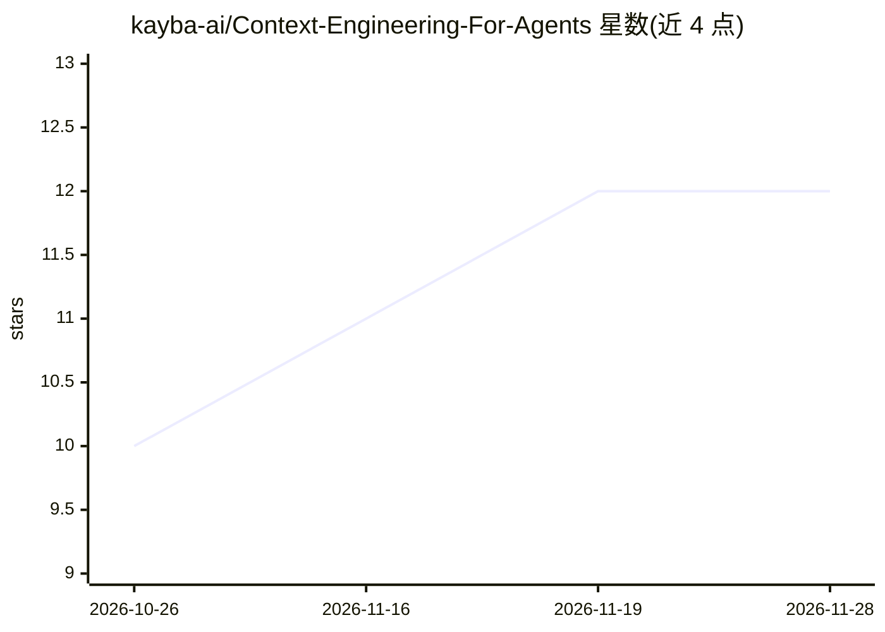

# kayba-ai/Context-Engineering-For-Agents

⭐ 12 · 推送 2025-12-02 · [GitHub](https://github.com/kayba-ai/Context-Engineering-For-Agents) · [官网](https://kayba.ai/) · 组织维护

**为 agent 开发者讲解上下文工程原理与实践的教程指南**

面向构建 AI agent 的开发者，梳理上下文工程知识：解释注意力预算与 context rot 等失效机制，区分语义/情景/程序性三类记忆，介绍静态上下文、压缩、结构化笔记、子代理架构与动态学习系统等管理方法，并归纳最小高信号 token、按需加载、提示抽象层级与工具设计四项原则。文中引用 Stanford ACE 框架及作者开源实现 agentic-context-engine，附外部资源清单。

## 筛选速览

| 维度 | 判定 | 备注 |
|---|---|---|
| AI 角色 | `ai-knowledge` | 知识聚合/清单类 |
| 许可风险 | `none` | — |
| 部署形态 | `None` |  |
| 模型依赖 | — | README 未给出锁定关系 |
| 硬件要求 | — | 无带数字的原话,不猜 |
| 安装摩擦 | `low` | 无编译、无系统依赖或容器化 |
| 成熟度 | — | 结构信号不足 |

## 能力要点

- 解释上下文失效机制：干扰项、结构悖论、位置效应
- 梳理语义/情景/程序性三类 agent 记忆及各自局限
- 介绍压缩、结构化笔记、子代理等长任务上下文技术
- 给出四项上下文工程原则并附 Stanford ACE 等参考资源

## 适用场景

- 为 agent 应用设计系统提示与上下文管理策略
- 处理超出上下文窗口的长任务（压缩/笔记/子代理）
- 了解为何堆更多上下文反而降低输出质量

## 场景标签

`教程课程` `提示工程` · 领域:Agent 开发

## 证据(README 行号)

> L1: # Context Engineering for Agents
> L44: RAG gives you semantic memory. Chat history gives you episodic memory. The challenge is building **procedural memor
> L103: The Stanford ACE framework formalizes this as a feedback loop between execution and curation. Our open-source impl

## 星数曲线

2026-10-26 10 → 2026-11-28 12（+2）

---
*卡片 v1 · prompt 1.4 · 生成 2026-11-18 · 置信度 high · 依据 README sha `b5392137d0e5` · [字段定义](../../DATASET.md)*
