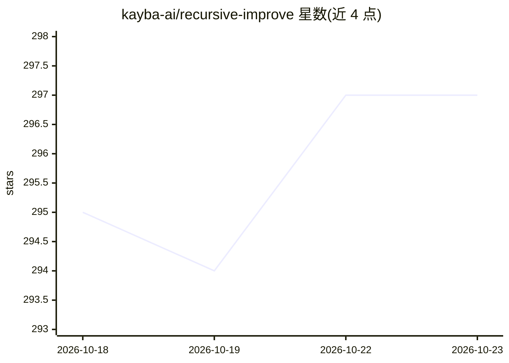

# kayba-ai/recursive-improve

⭐ 297 · Python · Apache-2.0 · 推送 2026-03-31 · [GitHub](https://github.com/kayba-ai/recursive-improve) · [官网](https://kayba.ai/) · 组织维护

**让编码 agent 递归自我改进的追踪与评测工具**

面向自建 agent 开发者的改进闭环工具：ri.patch() 对 OpenAI/Anthropic/LiteLLM 客户端打补丁，把每次 LLM 调用保存为本地 trace；/recursive-improve 技能在 Claude Code 或 Codex 中运行，走结构化管线（构建上下文→分析 trace→内置检测器测量→分诊计划→人工审批→分支上修复），并配套 benchmark 快照对比、Web dashboard 可视化与 /ratchet 夜间自主循环。每轮改进独立成分支，修复可溯源到具体洞察与指标。通过 uv 从 GitHub 源码安装。

## 筛选速览

| 维度 | 判定 | 备注 |
|---|---|---|
| AI 角色 | `ai-ecosystem` | LLM/agent 周边工具 |
| 许可风险 | `permissive` | Apache-2.0 |
| 部署形态 | `library` | 以包/库形式分发 |
| 模型依赖 | — | README 未给出锁定关系 |
| 硬件要求 | — | 无带数字的原话,不猜 |
| 安装摩擦 | `low` | 无编译、无系统依赖或容器化 |
| 成熟度 | — | 结构信号不足 |

## 能力要点

- monkey-patch 捕获 OpenAI/Anthropic/LiteLLM 调用并保存 trace JSON
- /recursive-improve 结构化管线：trace 分析→评测→计划→审批→分支修复
- benchmark 指标快照与跨轮次自动对比
- /ratchet 夜间自主循环：改进→运行→评测→保留或回退

## 适用场景

- 我的 agent 反复犯同样的错误，想从运行 trace 中找出失败模式并修复
- 希望每次改进有指标对照，确认改动真的有效
- 让编码 agent 夜间自动迭代优化并只保留有提升的改动

## 场景标签

`编码 Agent` `模型评测` `LLM 可观测性` · 领域:编码与开发

## 证据(README 行号)

> L21: Your agent runs. Every LLM call is captured. Your coding agent analyzes the traces, identifying common failure patt
> L136: - **`ri.patch()`**: monkey-patches OpenAI, Anthropic, and LiteLLM clients to capture every call
> L139: - **`recursive-improve benchmark`**: snapshot metric quality, store, and compare over time

## 星数曲线

2026-10-18 295 → 2026-10-23 297（+2）

---
*卡片 v1 · prompt 1.4 · 生成 2026-10-22 · 置信度 mid · 依据 README sha `89e942d274c0` · [字段定义](../../DATASET.md)*
