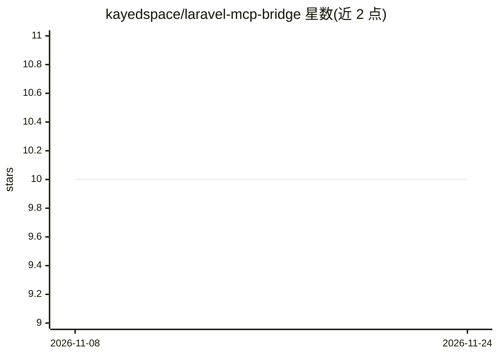

# kayedspace/laravel-mcp-bridge

⭐ 10 · PHP · MIT · 推送 2026-11-06 · [GitHub](https://github.com/kayedspace/laravel-mcp-bridge) · [官网](https://laravel-mcp-bridge.kayed.dev) · 个人维护

**把 Laravel 应用暴露为 MCP 服务器供 AI agent 调用的桥接包**

基于官方 laravel/mcp 包构建的 Laravel 扩展：将路由、Artisan 命令、队列任务、action 类、Eloquent 模型等八类来源暴露为 MCP 工具，复用应用已有的中间件、FormRequest 验证、guards、gates 与 policies 做授权。提供默认与 ops 两个 MCP 端点、带 scope/ability 的 token 机制、审计日志、破坏性工具二次确认与幂等键，以及 Artisan 管理命令和测试辅助。面向 Laravel 开发者。

## 筛选速览

| 维度 | 判定 | 备注 |
|---|---|---|
| AI 角色 | `ai-ecosystem` | LLM/agent 周边工具 |
| 许可风险 | `permissive` | MIT |
| 部署形态 | `None` |  |
| 模型依赖 | — | README 未给出锁定关系 |
| 硬件要求 | — | 无带数字的原话,不猜 |
| 安装摩擦 | `low` | 无编译、无系统依赖或容器化 |
| 成熟度 | — | 结构信号不足 |

## 能力要点

- 八类来源（路由/命令/任务/action/模型/远程/OpenAPI 等）可暴露为 MCP 工具
- 默认与 ops 双端点分离面向用户 agent 与运维 agent 的工具目录与 token
- token 带 scope 与 90 天过期，支持 Sanctum/Passport token 与 accessMcp gate
- 破坏性工具预览确认、幂等键、审计日志与 mcp-bridge:kill 运行时开关

## 适用场景

- 让 AI agent 以用户既有权限调用我的 Laravel API
- 把运维命令与内部任务暴露给运维 agent 而不共用用户 token
- 在 CI 中用 lint 与契约快照防止工具意外变更

## 场景标签

 · 领域:AI agent 基础设施/开发者工具

## 证据(README 行号)

> L1: Laravel MCP Bridge: turn your Laravel app into an MCP server for AI agents. Your authentication, gates and policies 
> L10: Your Laravel application already describes every input with FormRequests and decides every call with guards, gates 
> L71: |`ops`|`/mcp/ops`|Commands, jobs, actions, models, remote servers and OpenAPI documents|Operators and internal agen

## 星数曲线

2026-11-08 10 → 2026-11-24 10（+0）

---
*卡片 v1 · prompt 1.4 · 生成 2026-11-19 · 置信度 high · 依据 README sha `42ae263593ea` · [字段定义](../../DATASET.md)*
