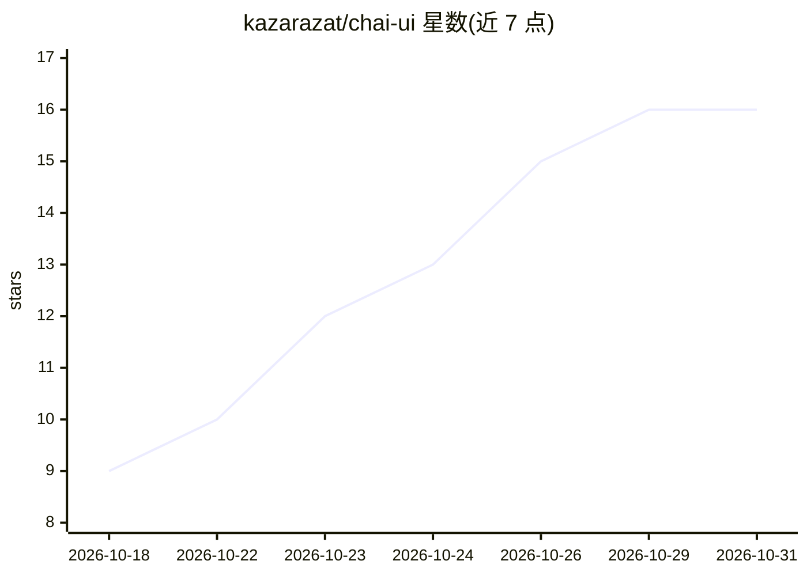

# kazarazat/chai-ui

⭐ 16 · TypeScript · MIT · 推送 2026-10-30 · [GitHub](https://github.com/kazarazat/chai-ui) · [官网](https://chai-ui.com) · 个人维护

**面向 AI 应用的设计系统组件库，统一界面操控多种生成模型**

基于 Material Design 3 的组件库，提供 Composer 提示栏、MediaAnalyzer 媒体转提示词、ResultCard 结果展示、EditCard 图像分区编辑四类组件，覆盖 React 18.3/19、Vue 3.5、Svelte 5 三框架，配套无框架数据层与设计 tokens。通过引擎抽象接入 Fal.ai、OpenRouter、Vercel AI Gateway 或自有引擎，API key 保留在用户服务端。组件支持 WCAG 2.2 AA 并以 axe 在真实浏览器中测试；附 DESIGN.md 与 llms.txt 供 AI agent 读取。MIT 许可。

## 筛选速览

| 维度 | 判定 | 备注 |
|---|---|---|
| AI 角色 | `ai-ecosystem` | LLM/agent 周边工具 |
| 许可风险 | `permissive` | MIT |
| 部署形态 | `library` | 以包/库形式分发 |
| 模型依赖 | locked-api |  |
| 硬件要求 | — | 无带数字的原话,不猜 |
| 安装摩擦 | `low` | 无编译、无系统依赖或容器化 |
| 成熟度 | — | 结构信号不足 |

## 能力要点

- Composer 提示栏支持图像/视频/音频/文本/世界模型，带附件与模型菜单
- 多引擎接入：Fal.ai、OpenRouter、Vercel AI Gateway 或自有引擎
- 三框架同组件同测试，API key 留在服务端
- 无引擎时可用内置 mock 运行，无需网络与密钥

## 适用场景

- 为生成式 AI 应用快速搭建统一的多模型交互界面
- 在 React/Vue/Svelte 项目中集成提示输入与结果展示组件
- 让 AI agent 依据 DESIGN.md 与 llms.txt 自动完成 UI 集成

## 场景标签

 · 领域:前端/AI 应用界面

## 证据(README 行号)

> L14: **A design system for AI model interactions.** Every component comes with
> L16: styled by your design tokens, and runs on Fal.ai, OpenRouter, Vercel AI

## 星数曲线

2026-10-18 9 → 2026-10-31 16（+7）

---
*卡片 v1 · prompt 1.4 · 生成 2026-10-30 · 置信度 high · 依据 README sha `a13f14174a6f` · [字段定义](../../DATASET.md)*
