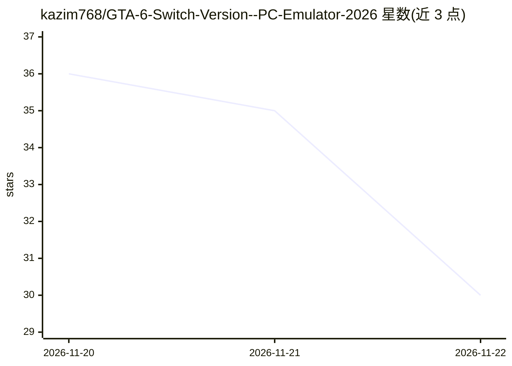

# kazim768/GTA-6-Switch-Version--PC-Emulator-2026

⭐ 30 · Rust · Apache-2.0 · 推送 2026-11-21 · [GitHub](https://github.com/kazim768/GTA-6-Switch-Version--PC-Emulator-2026) · 个人维护

**GTA VI PC 版安装准备与配置指南及 Windows 伴侣工具**

面向 Windows 10/11 用户的 GTA VI PC 版准备资源：提供系统环境检查、显卡驱动更新指引、存储检查、Rockstar Games Launcher 准备、图形与 FPS 优化建议、安装故障排查等内容。仓库声明其安装器为不含 GTA VI 游戏文件的 Windows 设置伴侣工具。README 明确 PC 版发布日期与官方硬件要求均未公布，多个章节以待官方信息发布后更新。页面含大量 SEO 关键词章节。

## 筛选速览

| 维度 | 判定 | 备注 |
|---|---|---|
| AI 角色 | `ai-knowledge` | 知识聚合/清单类 |
| 许可风险 | `permissive` | Apache-2.0 |
| 部署形态 | `desktop` | 安装包/桌面程序 |
| 模型依赖 | — | README 未给出锁定关系 |
| 硬件要求 | — | 无带数字的原话,不猜 |
| 安装摩擦 | `low` | 无编译、无系统依赖或容器化 |
| 成熟度 | `idea` | |

## 能力要点

- Windows 兼容性准备清单（DirectX、驱动、存储、系统更新检查）
- 图形设置与 FPS 排查通用建议（分辨率、阴影、上采样、帧生成等）
- NVIDIA/AMD/Intel 官方驱动下载链接汇总
- 常见安装错误与性能问题分类排查条目

## 适用场景

- 为将来 GTA VI PC 版上线提前准备 Windows 环境
- 更新显卡驱动并检查存储与系统兼容性
- 参考通用 PC 游戏图形与 FPS 优化建议

## 场景标签

 · 领域:游戏/安装配置指南

## 证据(README 行号)

> L5: A dedicated PC installation and configuration resource for Grand Theft Auto VI, covering Windows preparation, graphi
> L19: The installation resource focuses on:
> L49: The companion installer does not contain or install GTA VI game files.

## 星数曲线

2026-11-20 36 → 2026-11-22 30（-6）

---
*卡片 v1 · prompt 1.4 · 生成 2026-11-22 · 置信度 mid · 依据 README sha `2fe487426686` · [字段定义](../../DATASET.md)*
