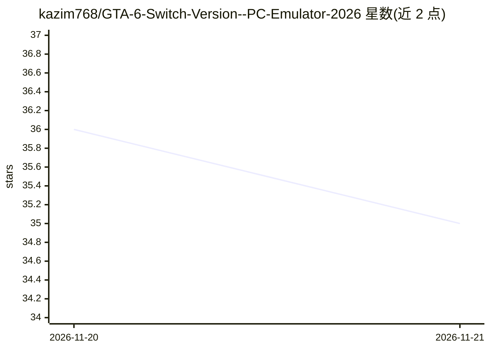

# kazim768/GTA-6-Switch-Version--PC-Emulator-2026

⭐ 35 · Rust · Apache-2.0 · 推送 2026-11-19 · [GitHub](https://github.com/kazim768/GTA-6-Switch-Version--PC-Emulator-2026) · 个人维护

**面向 Windows 玩家的 GTA VI PC 版安装与配置指南资源**

该仓库定位为 GTA VI PC 版的安装与配置文档资源，内容覆盖 Windows 环境准备（系统更新、GPU 驱动、存储检查）、Rockstar Games Launcher 准备、常见安装错误类别、FPS 与画面设置优化建议及故障排查清单。README 明确声明其配套安装器不包含也不安装 GTA VI 游戏文件，游戏需从授权渠道获取；官方 PC 版发布日期与硬件要求尚未公布，相关表格标注为未确认。仓库不含代码构建说明，主体为指南文档与下载页。主题标签含 ai/generative-ai，但 README 正文未出现 AI 相关功能描述。

## 筛选速览

| 维度 | 判定 | 备注 |
|---|---|---|
| AI 角色 | `ai-knowledge` | 知识聚合/清单类 |
| 许可风险 | `permissive` | Apache-2.0 |
| 部署形态 | `desktop` | 安装包/桌面程序 |
| 模型依赖 | — | README 未给出锁定关系 |
| 硬件要求 | — | 无带数字的原话,不猜 |
| 安装摩擦 | `low` | 无编译、无系统依赖或容器化 |
| 成熟度 | — | 结构信号不足 |

## 能力要点

- Windows 安装前检查清单：系统版本、DirectX、驱动、存储与硬件信息
- 图形设置与 FPS 排查条目（分辨率、纹理、阴影、V-Sync、帧生成等）
- 四类常见问题排查：低 FPS、卡顿、显示问题、安装错误
- 官方状态表标注 PC 版系统要求均未确认

## 适用场景

- GTA VI PC 版发布前提前准备 Windows 环境与驱动
- 排查 PC 游戏常见的低 FPS、卡顿与显示问题
- 查找 Rockstar 官方资源与启动器链接

## 场景标签

 · 领域:游戏/安装配置指南

## 证据(README 行号)

> L5: A dedicated PC installation and configuration resource for Grand Theft Auto VI, covering Windows preparation, graphi
> L17: This repository is dedicated to Windows users preparing for the future PC edition of GTA VI.
> L234: The PC version has not received an official release date as of November 18, 2026.

## 星数曲线

2026-11-20 36 → 2026-11-21 35（-1）

---
*卡片 v1 · prompt 1.4 · 生成 2026-11-20 · 置信度 mid · 依据 README sha `6954d37a13d3` · [字段定义](../../DATASET.md)*
