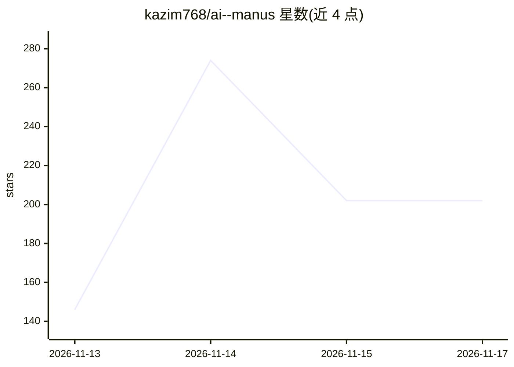

# kazim768/ai--manus

⭐ 202 · Apache-2.0 · 推送 2026-11-15 · [GitHub](https://github.com/kazim768/ai--manus) · 个人维护

**面向个人用户的自主 AI Agent：代跑代码与控制浏览器**

Manus 是一个自主运行的 AI agent，宣称可代替用户执行代码、控制浏览器完成网页导航/表单填写/信息收集，并执行多步骤日常任务（整理资料、组织文件等），定位为家庭、学习与轻量办公场景的个人助手，而非企业平台。README 提供硬件兼容表（最低双核 CPU、4GB 内存）与上手步骤说明，但未给出任何安装命令、下载链接或技术实现细节，仓库描述提到沙盒环境运行各类工具。

## 筛选速览

| 维度 | 判定 | 备注 |
|---|---|---|
| AI 角色 | `ai-native` | 本体是模型或模型工具 |
| 许可风险 | `permissive` | Apache-2.0 |
| 部署形态 | `None` |  |
| 模型依赖 | — | README 未给出锁定关系 |
| 硬件要求 | — | 无带数字的原话,不猜 |
| 安装摩擦 | `low` | 无编译、无系统依赖或容器化 |
| 成熟度 | — | 结构信号不足 |

## 能力要点

- 自主代码执行：agent 自行编写并运行脚本完成任务
- 浏览器控制：导航网页、填写表单、收集信息
- 代码与浏览器操作可在同一工作流中衔接
- 面向家庭/学习/轻量办公的小规模任务

## 适用场景

- 让学生整理研究笔记、跑快速计算
- 让远程工作者从多个网页收集数据
- 把重复性小任务委托给后台 agent 处理

## 场景标签

`AI 助手` `浏览器自动化` `GUI 自动化` · 领域:效率与自动化

## 证据(README 行号)

> L10: - **Autonomous Code Execution:** Manus AI agent runs code on its own to complete tasks, so you can focus on decisio
> L18: Manus is an autonomous AI agent designed to run code and control a browser on your behalf. Instead of acting like a

## 星数曲线

2026-11-13 146 → 2026-11-17 202（+56）

---
*卡片 v1 · prompt 1.4 · 生成 2026-11-17 · 置信度 mid · 依据 README sha `0f78ee3a5dd2` · [字段定义](../../DATASET.md)*
