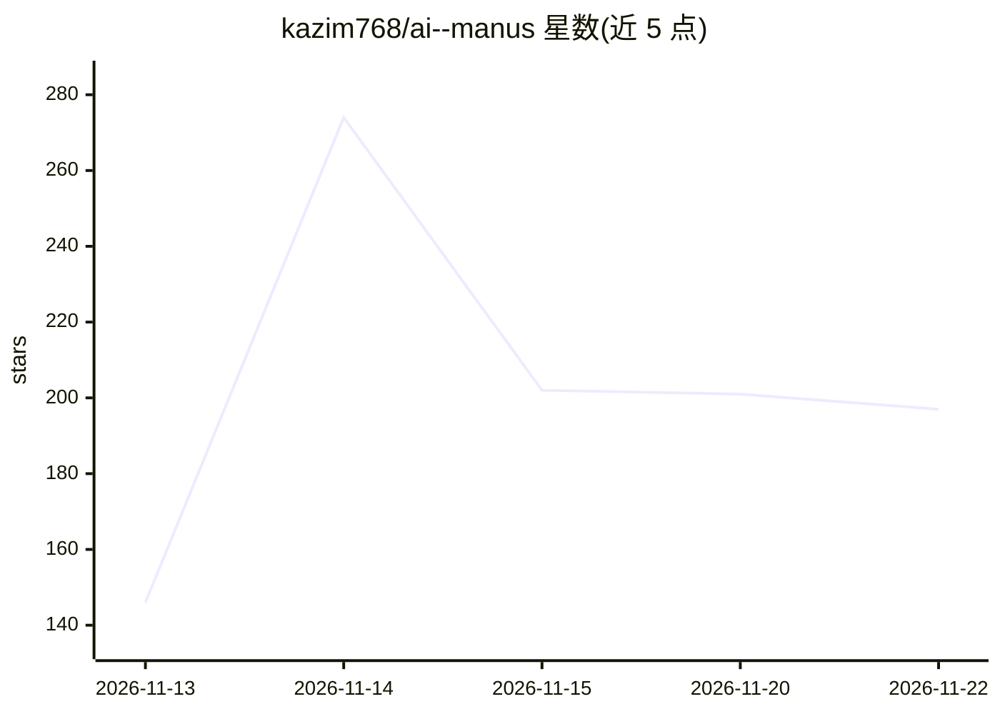

# kazim768/ai--manus

⭐ 197 · Apache-2.0 · 推送 2026-11-21 · [GitHub](https://github.com/kazim768/ai--manus) · 个人维护

**面向个人用户的自主 AI Agent，代为执行代码与浏览器任务**

自主 AI Agent 系统，可代用户执行脚本代码并控制浏览器：导航网页、填写表单、采集信息，并执行多步任务。定位为面向家庭、学习与轻度办公场景的个人助手，非企业平台；跨会话保留工作模式，任务可从脚本衔接至浏览器操作。README 提供最低软硬件要求（64 位系统、双核 CPU、4GB 内存）与使用流程（准备、配置、测试、应用），未给出具体安装命令或源码获取方式。

## 筛选速览

| 维度 | 判定 | 备注 |
|---|---|---|
| AI 角色 | `ai-native` | 本体是模型或模型工具 |
| 许可风险 | `permissive` | Apache-2.0 |
| 部署形态 | `None` |  |
| 模型依赖 | — | README 未给出锁定关系 |
| 硬件要求 | — | 无带数字的原话,不猜 |
| 安装摩擦 | `low` | 无编译、无系统依赖或容器化 |
| 成熟度 | — | 结构信号不足 |

## 能力要点

- 自主执行代码完成任务，无需逐步人工输入
- 代理控制浏览器：导航网页、填写表单、采集信息
- 支持多步任务编排，跨会话保持一致行为
- 给出最低系统要求（64 位、双核 CPU、4GB 内存）

## 适用场景

- 收集资料、运行小脚本、整理学习笔记
- 从多个网页页面采集数据用于工作汇报
- 把重复的填表、查网页等日常事务交给代理处理
- 快速运行小型实验脚本而无需搭建完整环境

## 场景标签

`AI 助手` `浏览器自动化` · 领域:效率与自动化

## 证据(README 行号)

> L18: Manus is an autonomous AI agent designed to run code and control a browser on your behalf. Instead of acting like a
> L41: |**Memory (RAM)**|4 GB|8 GB or more for heavy Manus autonomous tasks|

## 星数曲线

2026-11-13 146 → 2026-11-22 197（+51）

---
*卡片 v1 · prompt 1.4 · 生成 2026-11-22 · 置信度 mid · 依据 README sha `904ec7dc2a60` · [字段定义](../../DATASET.md)*
