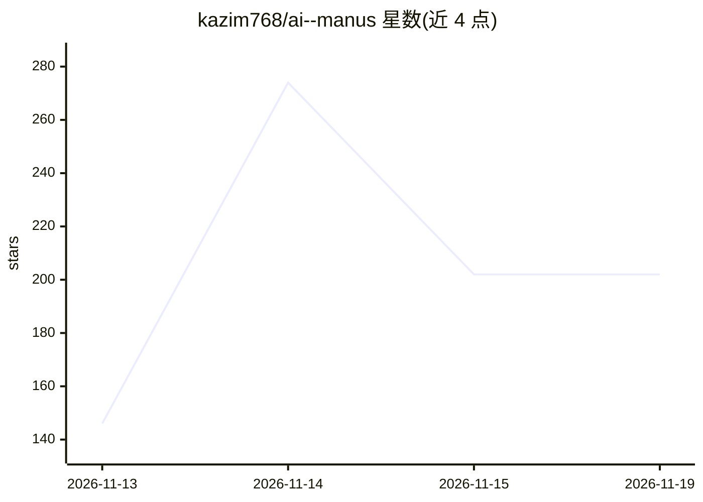

# kazim768/ai--manus

⭐ 202 · Apache-2.0 · 推送 2026-11-18 · [GitHub](https://github.com/kazim768/ai--manus) · 个人维护

**面向个人用户的自主 AI Agent：代为执行代码与浏览器任务**

README 描述 Manus 为通用自主 AI Agent：可自行编写并执行脚本、控制浏览器导航网页/填表/收集信息、执行多步任务，并跨会话记忆工作流。定位为面向家庭、学习与轻量办公场景的个人助手，面向学生、远程工作者等非开发者用户。README 未给出源码、依赖、API 配置或可验证的安装命令，仅提供下载入口与使用步骤说明。

## 筛选速览

| 维度 | 判定 | 备注 |
|---|---|---|
| AI 角色 | `ai-native` | 本体是模型或模型工具 |
| 许可风险 | `permissive` | Apache-2.0 |
| 部署形态 | `None` |  |
| 模型依赖 | — | README 未给出锁定关系 |
| 硬件要求 | — | 无带数字的原话,不猜 |
| 安装摩擦 | `low` | 无编译、无系统依赖或容器化 |
| 成熟度 | — | 结构信号不足 |

## 能力要点

- 自主执行代码与控制浏览器完成多步任务
- 跨会话保持工作流记忆与一致行为
- 面向非开发者的低门槛任务委托

## 适用场景

- 收集网页资料并整理研究笔记
- 自动填写重复表单或检查页面更新
- 运行小脚本做快速实验与文件整理

## 场景标签

`AI 助手` `编码 Agent` `浏览器自动化` · 领域:效率与自动化

## 证据(README 行号)

> L10: - **Autonomous Code Execution:** Manus AI agent runs code on its own to complete tasks, so you can focus on decisio
> L18: Manus is an autonomous AI agent designed to run code and control a browser on your behalf. Instead of acting like a
> L22: Manus is not a heavy studio suite or a complex enterprise platform. It is a focused helper built for home, study, a

## 星数曲线

2026-11-13 146 → 2026-11-19 202（+56）

---
*卡片 v1 · prompt 1.4 · 生成 2026-11-19 · 置信度 mid · 依据 README sha `2ff41025d9ff` · [字段定义](../../DATASET.md)*
