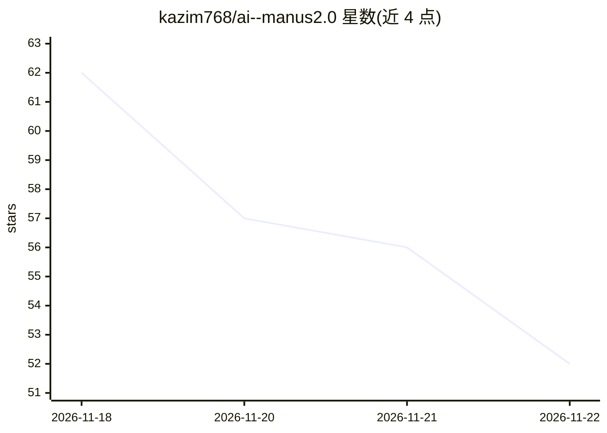

# kazim768/ai--manus2.0

⭐ 52 · Apache-2.0 · 推送 2026-11-21 · [GitHub](https://github.com/kazim768/ai--manus2.0) · 个人维护

**面向个人用户的自主 AI Agent，代为执行代码与浏览器操作**

README 介绍名为 Manus 的自主 AI Agent，可在用户授权下自主运行代码、控制浏览器（导航网页、填写表单、采集信息）并执行多步骤任务；定位为家庭、学习与轻量办公场景的个人助手，支持后台常驻与跨会话沿用已建立的流程。全文为功能与使用方式说明，未给出安装命令、下载链接或 API 接入说明，仅提供系统最低配置表（64 位系统、双核 CPU、4 GB 内存）。

## 筛选速览

| 维度 | 判定 | 备注 |
|---|---|---|
| AI 角色 | `ai-native` | 本体是模型或模型工具 |
| 许可风险 | `permissive` | Apache-2.0 |
| 部署形态 | `None` |  |
| 模型依赖 | — | README 未给出锁定关系 |
| 硬件要求 | — | 无带数字的原话,不猜 |
| 安装摩擦 | `low` | 无编译、无系统依赖或容器化 |
| 成熟度 | — | 结构信号不足 |

## 能力要点

- 自主代码执行：agent 自行运行脚本完成任务
- 浏览器控制：导航网站、填写表单、采集信息
- 后台常驻的个人助手模式，支持多步骤任务
- 提供系统与硬件最低配置说明

## 适用场景

- 让 agent 收集多个网页的信息并整理资料
- 自动化重复性的填表、查网页等日常事务
- 运行小脚本做快速计算或实验验证
- 轻量办公中整理参考资料和笔记

## 场景标签

`AI 助手` `浏览器自动化` · 领域:效率与自动化

## 证据(README 行号)

> L10: - **Autonomous Code Execution:** Manus AI agent runs code on its own to complete tasks, so you can focus on decisio
> L11: - **Browser Control Made Simple:** Manus browser control lets the agent navigate websites, fill forms, and gather i

## 星数曲线

2026-11-18 62 → 2026-11-22 52（-10）

---
*卡片 v1 · prompt 1.4 · 生成 2026-11-19 · 置信度 mid · 依据 README sha `5a9a053ed78d` · [字段定义](../../DATASET.md)*
