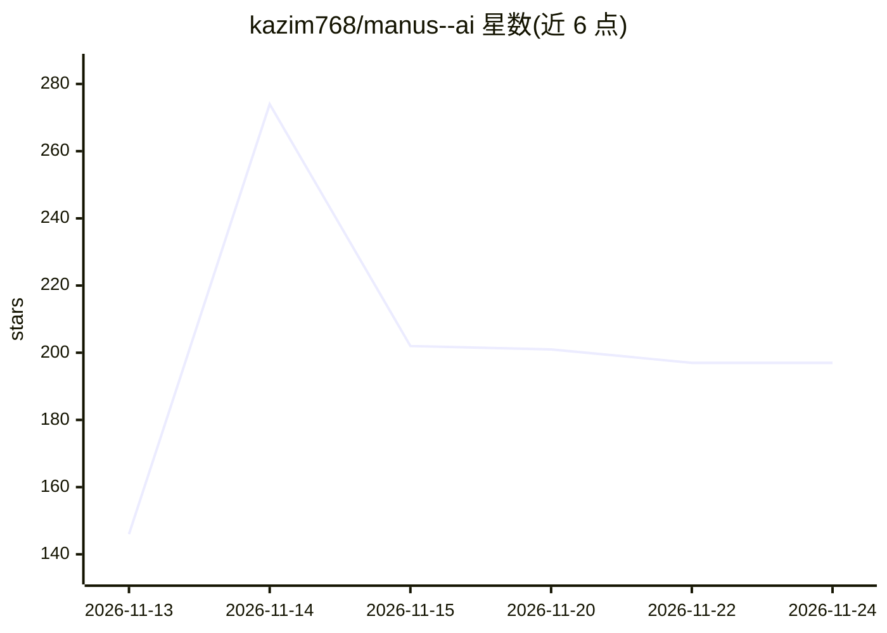

# kazim768/manus--ai

⭐ 197 · Apache-2.0 · 推送 2026-11-21 · [GitHub](https://github.com/kazim768/manus--ai) · 个人维护

**个人用户的自主 AI Agent，代为执行代码与浏览器操作**

README 将 Manus 描述为一个自主运行的 AI Agent：能自行编写并执行脚本、控制浏览器访问网页、填写表单、收集信息，并把多步骤任务串成完整流程。定位为面向家庭、学习与轻量办公场景的个人助手，无需编程背景即可委托任务；后台常驻，跨会话延续既有工作模式。README 未给出代码安装方式或命令行步骤，仅提供兼容性配置表与使用流程说明。

## 筛选速览

| 维度 | 判定 | 备注 |
|---|---|---|
| AI 角色 | `ai-native` | 本体是模型或模型工具 |
| 许可风险 | `permissive` | Apache-2.0 |
| 部署形态 | `None` |  |
| 模型依赖 | — | README 未给出锁定关系 |
| 硬件要求 | — | 无带数字的原话,不猜 |
| 安装摩擦 | `low` | 无编译、无系统依赖或容器化 |
| 成熟度 | — | 结构信号不足 |

## 能力要点

- 自主编写并执行代码完成任务
- 浏览器控制：导航、填表、收集信息
- 后台常驻的个人助理模式，跨会话延续工作模式
- 提供操作系统/CPU/内存/存储的兼容性配置表

## 适用场景

- 整理研究资料并运行小型脚本辅助学习
- 从多个网页收集信息并汇总成报告素材
- 把重复的填表、查页类杂事交给后台代理
- 远程排障时快速整理诊断步骤并检查系统页面

## 场景标签

`AI 助手` `编码 Agent` `浏览器自动化` · 领域:效率与自动化

## 证据(README 行号)

> L10: - **Autonomous Code Execution:** Manus AI agent runs code on its own to complete tasks, so you can focus on decisio
> L18: Manus is an autonomous AI agent designed to run code and control a browser on your behalf. Instead of acting like a
> L22: Manus is not a heavy studio suite or a complex enterprise platform. It is a focused helper built for home, study, a

## 星数曲线

2026-11-13 146 → 2026-11-24 197（+51）

---
*卡片 v1 · prompt 1.4 · 生成 2026-11-20 · 置信度 mid · 依据 README sha `148cfe63626f` · [字段定义](../../DATASET.md)*
