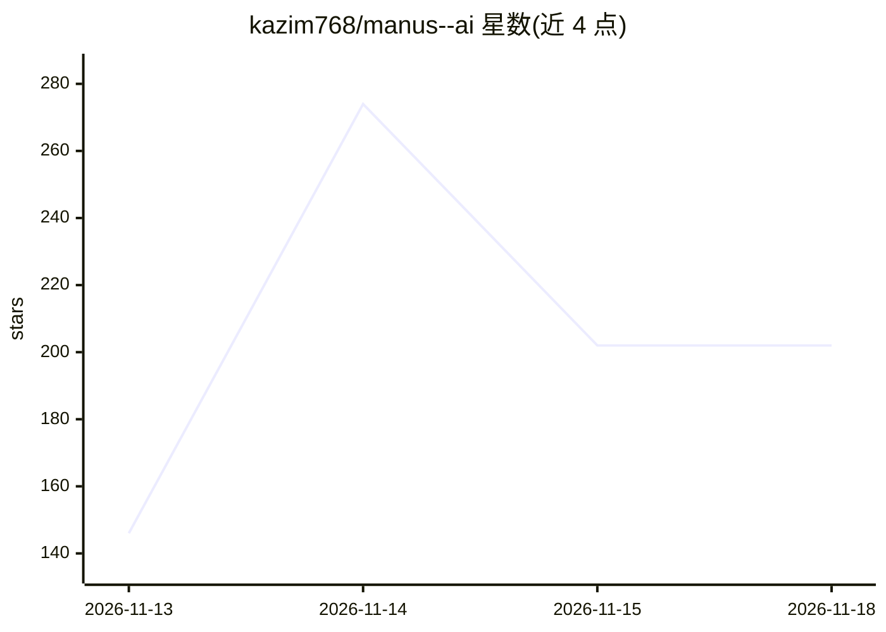

# kazim768/manus--ai

⭐ 202 · Apache-2.0 · 推送 2026-11-17 · [GitHub](https://github.com/kazim768/manus--ai) · 个人维护

**自主执行代码与控制浏览器的通用 AI Agent 系统**

README 描述的 Manus 是面向家庭、学习与轻量办公场景的自主 AI Agent：代表用户编写并执行脚本、控制浏览器（导航网页、填表、采集信息），并可跨会话复用任务模式执行多步骤自动化。仓库描述称其支持在沙箱环境中运行多种工具与操作。README 仅给出功能宣传与硬件兼容表（双核 CPU / 4GB RAM 起步），未提供代码结构、模型接入方式或安装运行命令，工程实现细节无法从可见文本验证。

## 筛选速览

| 维度 | 判定 | 备注 |
|---|---|---|
| AI 角色 | `ai-native` | 本体是模型或模型工具 |
| 许可风险 | `permissive` | Apache-2.0 |
| 部署形态 | `None` |  |
| 模型依赖 | — | README 未给出锁定关系 |
| 硬件要求 | — | 无带数字的原话,不猜 |
| 安装摩擦 | `low` | 无编译、无系统依赖或容器化 |
| 成熟度 | — | 结构信号不足 |

## 能力要点

- 自主编写并执行代码完成任务
- 浏览器控制：导航、填表、信息采集
- 跨会话记住任务模式并复用
- 面向多步骤任务的低监督执行

## 适用场景

- 让学生整理研究笔记、运行小型计算
- 自动检查网页更新或填写重复表单
- 跨多个页面收集数据并准备摘要
- 远程排障时重排诊断步骤与检查系统页面

## 场景标签

`浏览器自动化` `编码 Agent` `AI 助手` · 领域:效率与自动化

## 证据(README 行号)

> L10: - **Autonomous Code Execution:** Manus AI agent runs code on its own to complete tasks, so you can focus on decisio
> L18: Manus is an autonomous AI agent designed to run code and control a browser on your behalf. Instead of acting like a

## 星数曲线

2026-11-13 146 → 2026-11-18 202（+56）

---
*卡片 v1 · prompt 1.4 · 生成 2026-11-18 · 置信度 low · 依据 README sha `c06e59c45084` · [字段定义](../../DATASET.md)*
