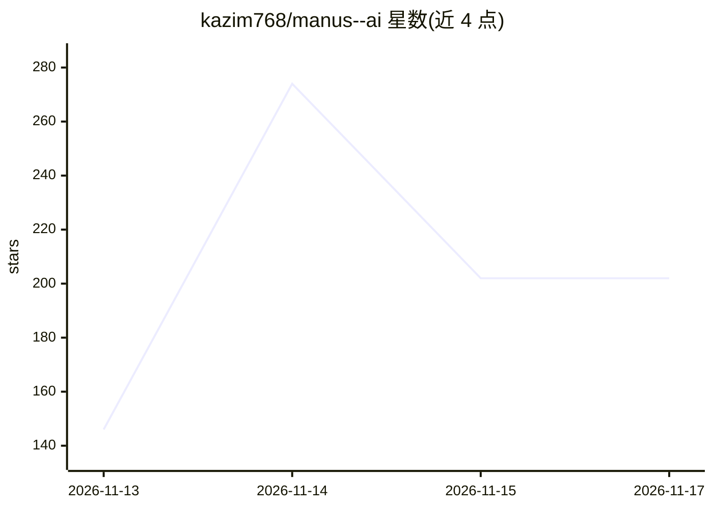

# kazim768/manus--ai

⭐ 202 · Apache-2.0 · 推送 2026-11-15 · [GitHub](https://github.com/kazim768/manus--ai) · 个人维护

**自主 AI Agent：代用户执行代码并控制浏览器完成任务**

面向家庭、学习与轻量办公场景的自主 AI Agent 应用：用户以自然语言下达任务，Agent 自行编写并执行脚本、控制浏览器完成导航、填表、信息收集等多步操作，可在后台持续运行。README 提及需稳定网络连接与运行后台助手的权限，给出最低双核 CPU、4GB 内存的兼容性参考，但未提供具体安装命令、模型接入方式或 API 细节，代码仓库描述称支持沙箱环境中运行多种工具。

## 筛选速览

| 维度 | 判定 | 备注 |
|---|---|---|
| AI 角色 | `ai-native` | 本体是模型或模型工具 |
| 许可风险 | `permissive` | Apache-2.0 |
| 部署形态 | `None` |  |
| 模型依赖 | — | README 未给出锁定关系 |
| 硬件要求 | — | 无带数字的原话,不猜 |
| 安装摩擦 | `low` | 无编译、无系统依赖或容器化 |
| 成熟度 | — | 结构信号不足 |

## 能力要点

- 自主执行代码与控制浏览器，完成多步任务
- 面向家庭、学习、轻量办公等小规模场景
- 会话间保持任务模式的一致性
- 给出最低硬件兼容性参考（双核 CPU / 4GB 内存）

## 适用场景

- 让 Agent 代为浏览网页收集资料并整理摘要
- 自动执行小脚本完成重复性计算与文件整理
- 学习与远程工作中委派耗时的重复性任务

## 场景标签

`浏览器自动化` · 领域:效率与自动化

## 证据(README 行号)

> L10: - **Autonomous Code Execution:** Manus AI agent runs code on its own to complete tasks, so you can focus on decisio
> L18: Manus is an autonomous AI agent designed to run code and control a browser on your behalf. Instead of acting like a

## 星数曲线

2026-11-13 146 → 2026-11-17 202（+56）

---
*卡片 v1 · prompt 1.4 · 生成 2026-11-17 · 置信度 mid · 依据 README sha `0f78ee3a5dd2` · [字段定义](../../DATASET.md)*
