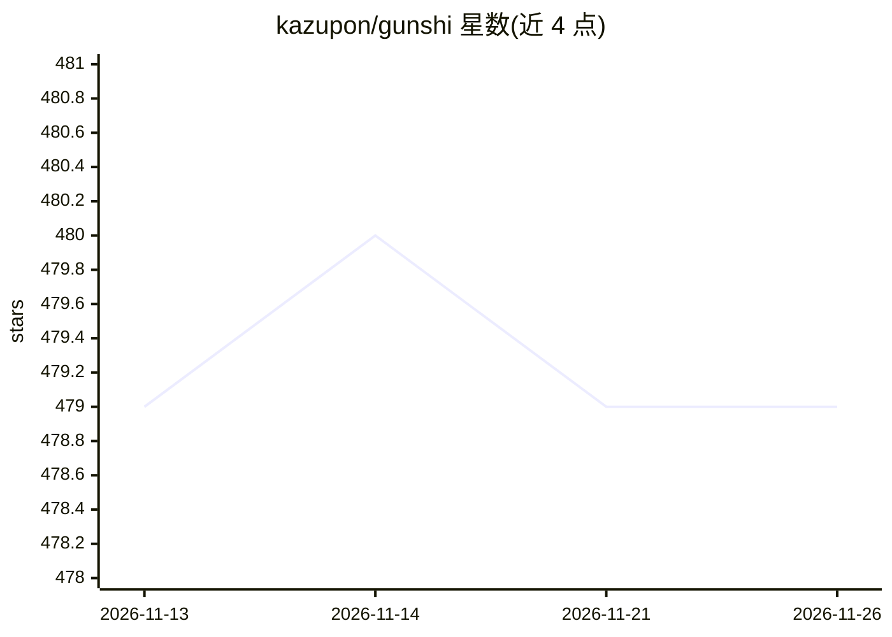

# kazupon/gunshi

⭐ 479 · TypeScript · MIT · 推送 2026-11-23 · [GitHub](https://github.com/kazupon/gunshi) · [官网](https://gunshi.dev) · 个人维护

**面向人类与 AI agent 使用 CLI 的 JavaScript 命令行库**

Gunshi 是一个 JavaScript 命令行库，用于构建现代 CLI：声明式命令配置与 args-tokens 类型安全参数解析、子命令组合与懒加载、可插拔渲染器（usage/校验错误/help）、内置国际化（locale 感知与多语言资源）、带依赖管理与生命周期钩子的插件系统。AI 相关特性为 JSON 输出与检测 AI agent 调用。通过 npm 安装，MIT 许可，文档由 cline 与 claude 3.7 sonnet 生成示例与文档。

## 筛选速览

| 维度 | 判定 | 备注 |
|---|---|---|
| AI 角色 | `ai-enhanced` | 去掉 AI 部分产品仍成立 |
| 许可风险 | `permissive` | MIT |
| 部署形态 | `library` | 以包/库形式分发 |
| 模型依赖 | — | README 未给出锁定关系 |
| 硬件要求 | — | 无带数字的原话,不猜 |
| 安装摩擦 | `low` | 无编译、无系统依赖或容器化 |
| 成熟度 | — | 结构信号不足 |

## 能力要点

- 声明式命令配置与 args-tokens 类型安全参数解析
- 子命令模块化组合、上下文共享与懒加载
- 可插拔渲染器与插件系统（依赖管理、生命周期钩子）
- 内置国际化支持，JSON 输出并检测 AI agent

## 适用场景

- 用 TypeScript 构建带子命令的模块化 CLI 工具
- 编写可供 AI coding agent 调用的命令行接口
- 构建需要多语言 help 信息与本地化的 CLI

## 场景标签

 · 领域:开发工具/CLI 库

## 证据(README 行号)

> L9: Gunshi is a JavaScript command-line library, your strategist for CLIs that people and AI agents use.
> L18: - 📏 **Simple & AI agent friendly**: Commands with simple APIs, output as JSON, and detects AI agents.

## 星数曲线

2026-11-13 479 → 2026-11-26 479（+0）

---
*卡片 v1 · prompt 1.4 · 生成 2026-11-25 · 置信度 high · 依据 README sha `78d9ac16b33a` · [字段定义](../../DATASET.md)*
