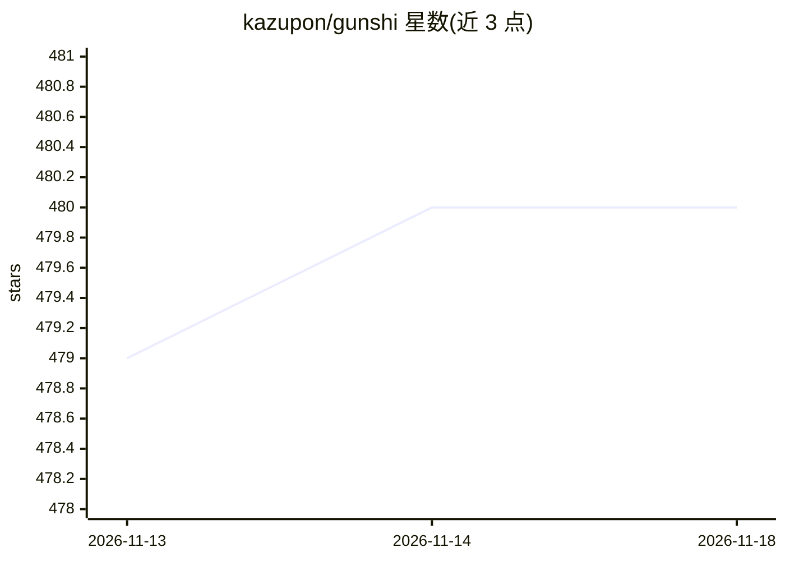

# kazupon/gunshi

⭐ 480 · TypeScript · MIT · 推送 2026-11-17 · [GitHub](https://github.com/kazupon/gunshi) · [官网](https://gunshi.dev) · 个人维护

**面向人类与 AI Agent 的 JavaScript 命令行库**

JavaScript/TypeScript 命令行构建库，提供声明式命令配置、基于 args-tokens 的类型安全参数解析、可组合的懒加载子命令、可插拔的渲染器与插件系统、多语言支持。其 AI 相关特性包括 JSON 输出与 AI agent 检测，便于编码代理使用所构建的 CLI。通过 npm 安装，供开发者在自己的项目中引用。

## 筛选速览

| 维度 | 判定 | 备注 |
|---|---|---|
| AI 角色 | `ai-ecosystem` | LLM/agent 周边工具 |
| 许可风险 | `permissive` | MIT |
| 部署形态 | `library` | 以包/库形式分发 |
| 模型依赖 | — | README 未给出锁定关系 |
| 硬件要求 | — | 无带数字的原话,不猜 |
| 安装摩擦 | `low` | 无编译、无系统依赖或容器化 |
| 成熟度 | — | 结构信号不足 |

## 能力要点

- 命令输出为 JSON 并检测 AI agent
- 声明式配置与 TypeScript 类型安全的参数解析
- 可组合子命令、懒加载与插件系统
- 内置国际化与多语言支持

## 适用场景

- 为我的工具构建类型安全的命令行界面
- 让 AI 编码代理能够使用我构建的 CLI 命令
- 组织多语言、多子命令的模块化 CLI 项目

## 场景标签

 · 领域:开发工具/CLI 库

## 证据(README 行号)

> L9: Gunshi is a JavaScript command-line library, your strategist for CLIs that people and AI agents use.
> L18: - 📏 **Simple & AI agent friendly**: Commands with simple APIs, output as JSON, and detects AI agents.

## 星数曲线

2026-11-13 479 → 2026-11-18 480（+1）

---
*卡片 v1 · prompt 1.4 · 生成 2026-11-17 · 置信度 high · 依据 README sha `28401cc5a530` · [字段定义](../../DATASET.md)*
