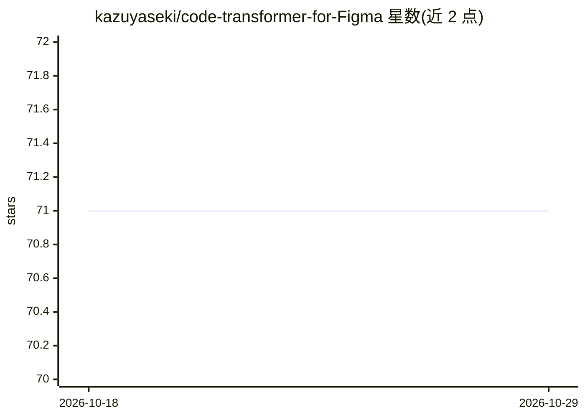

# kazuyaseki/code-transformer-for-Figma

⭐ 71 · TypeScript · 推送 2026-10-27 · [GitHub](https://github.com/kazuyaseki/code-transformer-for-Figma) · 个人维护

**Figma 插件：用 OpenAI API 从设计稿生成代码**

面向 Figma 用户的插件，调用 OpenAI API（gpt-3.5-turbo）将选中的设计内容转换为代码，并可将结果推送到指定的 GitHub 仓库（需在 .env 中配置 OpenAI API key、GitHub API key 及仓库信息）。开发方式为 npm 安装依赖后构建，再通过 Figma 桌面端从 manifest.json 导入插件。README 注明当前 gpt-3.5-turbo 生成的代码质量有限。基于 Create Figma Plugin 构建，由 Gaudiy 赞助。

## 筛选速览

| 维度 | 判定 | 备注 |
|---|---|---|
| AI 角色 | `ai-native` | 本体是模型或模型工具 |
| 许可风险 | `none` | — |
| 部署形态 | `library` | 以包/库形式分发 |
| 模型依赖 | — | README 未给出锁定关系 |
| 硬件要求 | — | 无带数字的原话,不猜 |
| 安装摩擦 | `low` | 无编译、无系统依赖或容器化 |
| 成熟度 | — | 结构信号不足 |

## 能力要点

- 调用 OpenAI API 从 Figma 设计生成代码
- 支持将生成结果推送到指定 GitHub 仓库
- 基于 Create Figma Plugin 构建，含 watch 自动重建

## 适用场景

- 在 Figma 中直接把设计稿转成代码
- 将生成代码自动推送到自己的 GitHub 仓库

## 场景标签

`代码生成` · 领域:编码与开发

## 证据(README 行号)

> L9: Figma Plugin to generate code using OpenAI API.
> L17: First create .env file and set your OpenAI API key and GitHub API key, repository owner and name where you would wa

## 星数曲线

2026-10-18 71 → 2026-10-29 71（+0）

---
*卡片 v1 · prompt 1.4 · 生成 2026-10-24 · 置信度 high · 依据 README sha `9870dbb6878d` · [字段定义](../../DATASET.md)*
