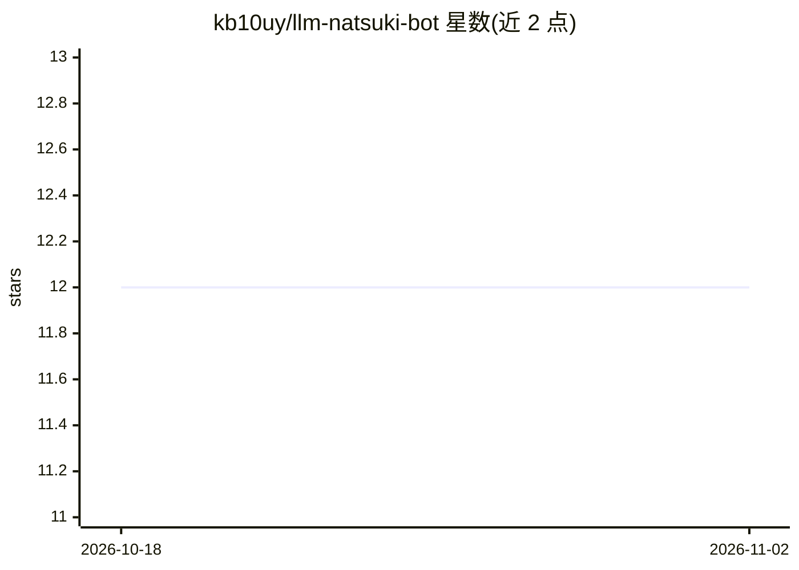

# kb10uy/llm-natsuki-bot

⭐ 12 · Rust · Apache-2.0 · 推送 2026-11-01 · [GitHub](https://github.com/kb10uy/llm-natsuki-bot) · [官网](https://kb10uy.org/llm-natsuki-bot/) · 个人维护

**Rust 实现的 LLM 聊天机器人，接入 Mastodon 与 Discord**

以 Rust 编写的 LLM 聊天机器人/助手，面向在 Mastodon 或 Discord 平台部署聊天机器人的用户。LLM 侧支持 OpenAI API 及其兼容接口，提供 Chat Completion 与 Responses 两种调用方式。README 另列出基础手册、DeepWiki 与作者问答等链接，并标注 GitHub 提交活跃度、CI 状态与许可证徽章。开发通过 cargo xtask 命令进行。README 未说明具体部署配置细节。

## 筛选速览

| 维度 | 判定 | 备注 |
|---|---|---|
| AI 角色 | `ai-native` | 本体是模型或模型工具 |
| 许可风险 | `permissive` | Apache-2.0 |
| 部署形态 | `None` |  |
| 模型依赖 | — | README 未给出锁定关系 |
| 硬件要求 | — | 无带数字的原话,不猜 |
| 安装摩擦 | `low` | 无编译、无系统依赖或容器化 |
| 成熟度 | — | 结构信号不足 |

## 能力要点

- Rust 实现的 LLM 聊天机器人
- 支持 Mastodon 与 Discord 作为聊天平台
- 支持 OpenAI API（兼容）：Chat Completion 与 Responses

## 适用场景

- 在 Discord 服务器里挂一个 LLM 聊天机器人
- 在 Mastodon 账号上提供自动回复对话
- 用自选的 OpenAI 兼容 API 后端驱动机器人

## 场景标签

`聊天机器人` · 领域:对话与助手

## 证据(README 行号)

> L2: AI-powered chatbot implementation in Rust; it comes with various *humorous* features!
> L20: * Mastodon

## 星数曲线

2026-10-18 12 → 2026-11-02 12（+0）

---
*卡片 v1 · prompt 1.4 · 生成 2026-11-01 · 置信度 mid · 依据 README sha `f65955857e5e` · [字段定义](../../DATASET.md)*
