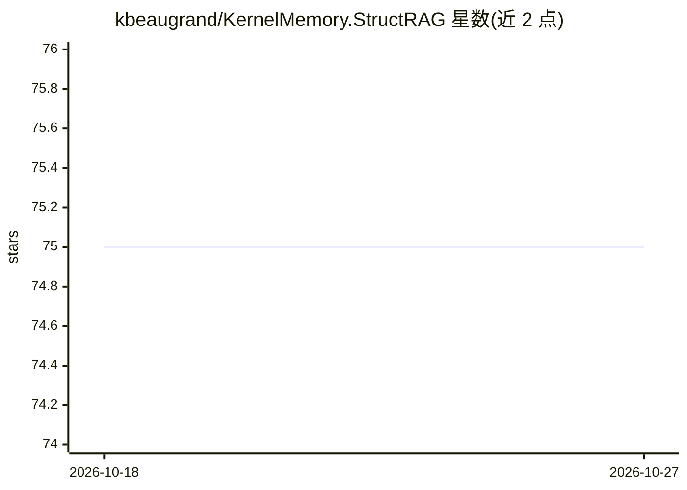

# kbeaugrand/KernelMemory.StructRAG

⭐ 75 · C# · MIT · 推送 2025-11-21 · [GitHub](https://github.com/kbeaugrand/KernelMemory.StructRAG) · 个人维护

**为 Kernel Memory 提供 StructRAG 检索的自定义搜索客户端库**

基于 .NET 的 NuGet 库，将 StructRAG 方法作为 Kernel Memory 的自定义搜索客户端接入：通过 KernelMemoryBuilder 配置 WithStructRagSearchClient，用 OpenAI 默认设置构建 MemoryServerless 实例。StructRAG 方法将原始信息转为结构化知识再推理，用于信息分散、需全局推理的场景。README 提供安装命令、配置代码示例与一个示例工程（向易失性内存库导入文档并提问）。MIT 许可。

## 筛选速览

| 维度 | 判定 | 备注 |
|---|---|---|
| AI 角色 | `ai-ecosystem` | LLM/agent 周边工具 |
| 许可风险 | `permissive` | MIT |
| 部署形态 | `None` |  |
| 模型依赖 | — | README 未给出锁定关系 |
| 硬件要求 | — | 无带数字的原话,不猜 |
| 安装摩擦 | `medium` | 含编译或系统依赖之一 |
| 成熟度 | — | 结构信号不足 |

## 能力要点

- 以 NuGet 包形式接入 Kernel Memory
- 实现 StructRAG 结构化知识检索方法
- 提供配置代码示例与文档问答示例工程

## 适用场景

- 在 .NET 项目中为 Kernel Memory 替换为 StructRAG 检索客户端
- 信息分散且需全局推理的知识问答场景
- 基于 OpenAI API 构建带引用来源的文档问答

## 场景标签

`RAG` · 领域:知识与检索

## 证据(README 行号)

> L8: > Note: Freely inspired from StructRag, this is an implemention of a custom seach client for Kernel Memory.
> L42: Configure you KernelMemory client to use the custom search client:
> L48:     .WithStructRagSearchClient()

## 星数曲线

2026-10-18 75 → 2026-10-27 75（+0）

---
*卡片 v1 · prompt 1.4 · 生成 2026-10-24 · 置信度 high · 依据 README sha `3ee99eda1a74` · [字段定义](../../DATASET.md)*
