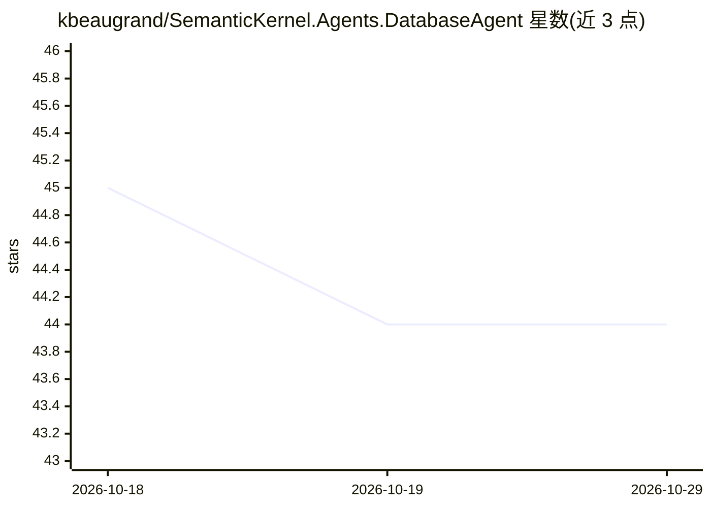

# kbeaugrand/SemanticKernel.Agents.DatabaseAgent

⭐ 44 · C# · MIT · 推送 2025-11-21 · [GitHub](https://github.com/kbeaugrand/SemanticKernel.Agents.DatabaseAgent) · 个人维护

**基于 Semantic Kernel 的 NL2SQL 数据库代理，自然语言生成并执行 SQL**

构建于 Microsoft Semantic Kernel 与 Kernel Memory 连接器之上的数据库代理服务：记忆数据库 schema 与关系，接收自然语言并生成、执行 SQL 查询（NL2SQL）。以 NuGet 包形式集成到 .NET 8 项目，也可作为 Docker 镜像运行 MCP Server，通过 SSE/HTTP 端点供 Claude Desktop 等 MCP 客户端调用。README 列出 10 个已测试模型及个人评分（以 gpt-4.1-mini 得分最高），并提供质量保障扩展包（查询相关性过滤、自定义 IQueryExecutionFilter）。同时声明 LLM 代理可能导致数据泄露与合规风险。

## 筛选速览

| 维度 | 判定 | 备注 |
|---|---|---|
| AI 角色 | `ai-native` | 本体是模型或模型工具 |
| 许可风险 | `permissive` | MIT |
| 部署形态 | `self-host` | docker 或自建部署 |
| 模型依赖 | — | README 未给出锁定关系 |
| 硬件要求 | — | 无带数字的原话,不猜 |
| 安装摩擦 | `low` | 无编译、无系统依赖或容器化 |
| 成熟度 | — | 结构信号不足 |

## 能力要点

- 借助 Semantic Kernel Memory 记忆数据库 schema 与关系实现 NL2SQL
- 可作 Docker 镜像运行 MCP Server，暴露 SSE/HTTP 端点
- 质量保障扩展：QueryRelevancyFilter 基于 LLM 生成描述与余弦相似度过滤查询
- 支持自定义 IQueryExecutionFilter 质量过滤器

## 适用场景

- 在我的 .NET 应用里用自然语言查询数据库
- 通过 Claude Desktop 等 MCP 客户端以对话方式操作数据库
- 为 LLM 生成的 SQL 增加安全与相关性校验

## 场景标签

`数据分析` · 领域:效率与自动化

## 证据(README 行号)

> L10: The Database Agent for Semantic Kernel is a service that provides a database management system (DBMS) for the Seman
> L11: This built on top of the Microsoft's Semantic Kernel and Semantic Kernel Memory connectors to memorize database sch
> L48: To use the Database Agent for Semantic Kernel, you must first install the package from NuGet.

## 星数曲线

2026-10-18 45 → 2026-10-29 44（-1）

---
*卡片 v1 · prompt 1.4 · 生成 2026-10-25 · 置信度 high · 依据 README sha `f70c0f9a3dd9` · [字段定义](../../DATASET.md)*
