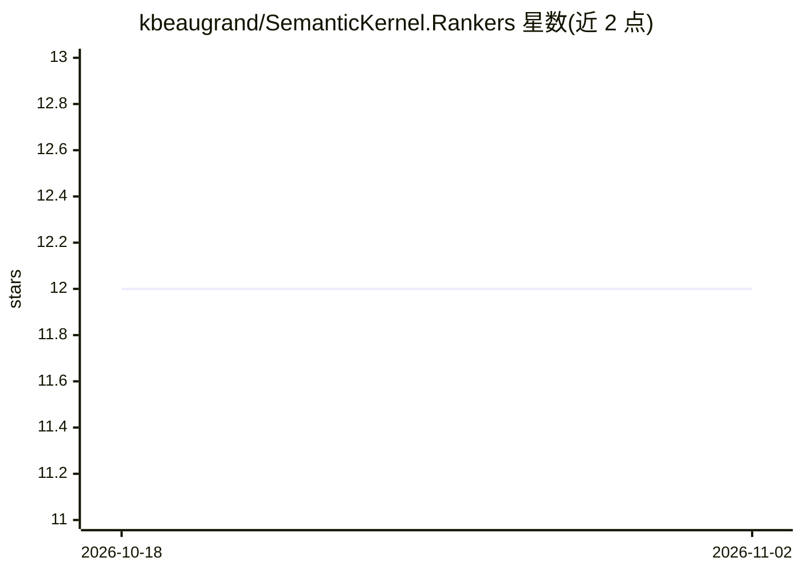

# kbeaugrand/SemanticKernel.Rankers

⭐ 12 · C# · MIT · 推送 2025-11-21 · [GitHub](https://github.com/kbeaugrand/SemanticKernel.Rankers) · 个人维护

**基于 Semantic Kernel 的 C# 搜索结果重排库**

为微软 Semantic Kernel 提供 C# 实现的重排组件：BM25Ranker（经 Catalyst NLP 支持分词、词形还原、停用词移除与多语言）、LMRanker（基于语言模型的语义重排），以及 CascadeRerankPipeline 与 BM25ThenLMRankerPipeline 两类级联管道，支持多阶段过滤、分数阈值、top-K/top-M 配置、泛型文档类型与异步流式处理，管道内置耗时、token 用量与分数的可观测数据。面向 .NET/C# 开发者，以三个 NuGet 包（BM25/LMRanker/Pipelines）分发，MIT 许可。

## 筛选速览

| 维度 | 判定 | 备注 |
|---|---|---|
| AI 角色 | `ai-ecosystem` | LLM/agent 周边工具 |
| 许可风险 | `permissive` | MIT |
| 部署形态 | `None` |  |
| 模型依赖 | — | README 未给出锁定关系 |
| 硬件要求 | — | 无带数字的原话,不猜 |
| 安装摩擦 | `medium` | 含编译或系统依赖之一 |
| 成熟度 | — | 结构信号不足 |

## 能力要点

- BM25Ranker 基于 Catalyst NLP 支持分词、词形还原、停用词移除与多语言
- LMRanker 利用语言模型做语义重排
- CascadeRerankPipeline 多级联过滤，支持阈值与 top-K/top-M 配置
- 管道内置耗时、token 用量与分数观测数据

## 适用场景

- 在 .NET RAG 系统中对检索结果做二次排序
- 组合 BM25 高召回与 LLM 语义重排的两阶段检索
- 为 Semantic Kernel 应用接入可配置的重排管道

## 场景标签

`语义搜索` · 领域:知识与检索

## 证据(README 行号)

> L14: This project provides a flexible C# implementation of Rankers for Microsoft's Semantic Kernel, including:
> L18: - **LMRanker**: A neural ranker leveraging advanced language models for semantic reranking.
> L49: A specialized two-stage retrieval pipeline optimized for RAG systems:

## 星数曲线

2026-10-18 12 → 2026-11-02 12（+0）

---
*卡片 v1 · prompt 1.4 · 生成 2026-11-01 · 置信度 high · 依据 README sha `1416aec19a24` · [字段定义](../../DATASET.md)*
