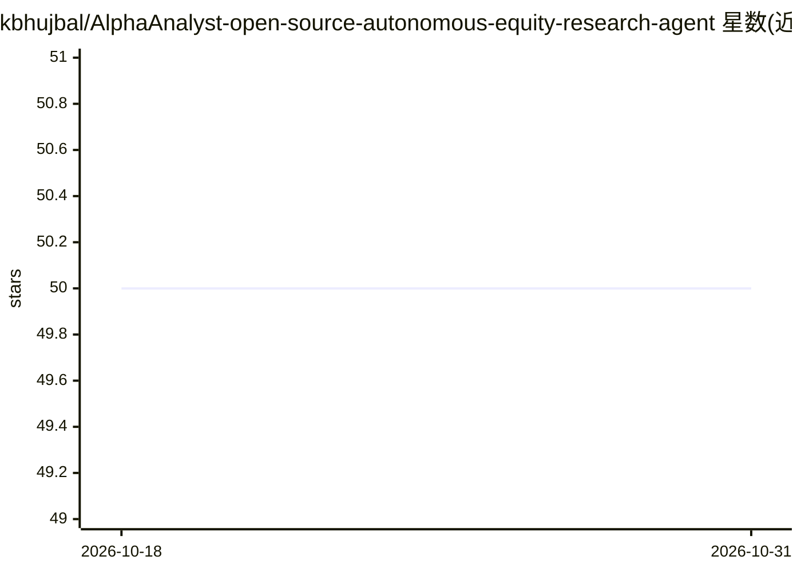

# kbhujbal/AlphaAnalyst-open-source-autonomous-equity-research-agent

⭐ 50 · Python · Apache-2.0 · 推送 2026-04-29 · [GitHub](https://github.com/kbhujbal/AlphaAnalyst-open-source-autonomous-equity-research-agent) · 个人维护

**输入美股代码自动生成带引用的研究备忘录的开源 agent**

输入一个美股 ticker，系统并发运行十个数据抓取器（SEC EDGAR、Polygon、FMP、Finnhub 等）获取财报与新闻，将长文档索引到 pgvector，再运行六个 LLM agent（含一个强制使用不同模型家族的 Devil's Advocate）生成含 DCF 估值、可比公司、电话会议语气、多空论证的研究备忘录。估值计算用纯 Python decimal.Decimal 完成，LLM 不参与算术；合成器对未溯源的数字章节降级，引文校验器核查引用真实性。前后端为 FastAPI + Next.js 14，需配置多项 API key，当前版本 v0.1 系列。

## 筛选速览

| 维度 | 判定 | 备注 |
|---|---|---|
| AI 角色 | `ai-native` | 本体是模型或模型工具 |
| 许可风险 | `permissive` | Apache-2.0 |
| 部署形态 | `library` | 以包/库形式分发 |
| 模型依赖 | — | README 未给出锁定关系 |
| 硬件要求 | — | 无带数字的原话,不猜 |
| 安装摩擦 | `low` | 无编译、无系统依赖或容器化 |
| 成熟度 | `idea` | |

## 能力要点

- 十个数据源并发抓取并索引到 pgvector RAG
- 六个 LLM agent 流水线，含跨模型家族的 Devil's Advocate
- DCF 与可比估值由纯 Python decimal.Decimal 计算，LLM 不触碰算术
- 引文校验：数字声明须回溯到 10-K 等一手来源，否则章节降级

## 适用场景

- 输入 ticker 生成可逐项审计数字来源的股票研究备忘录
- 获取含 DCF、可比公司、多空论证的分析师级报告草稿
- 导出 PDF 与含活公式的 Excel 估值模型

## 场景标签

`多智能体` `RAG` `科研工具` · 领域:Agent 开发

## 证据(README 行号)

> L3: AlphaAnalyst is an open-source autonomous equity research agent. Give it a US
> L18: Two design choices anchor the project: **the LLM is a writer, not a knower**
> L21: Python** (`decimal.Decimal` everywhere; no LLM ever touches an arithmetic

## 星数曲线

2026-10-18 50 → 2026-10-31 50（+0）

---
*卡片 v1 · prompt 1.4 · 生成 2026-10-24 · 置信度 high · 依据 README sha `0dd055e83f4b` · [字段定义](../../DATASET.md)*
