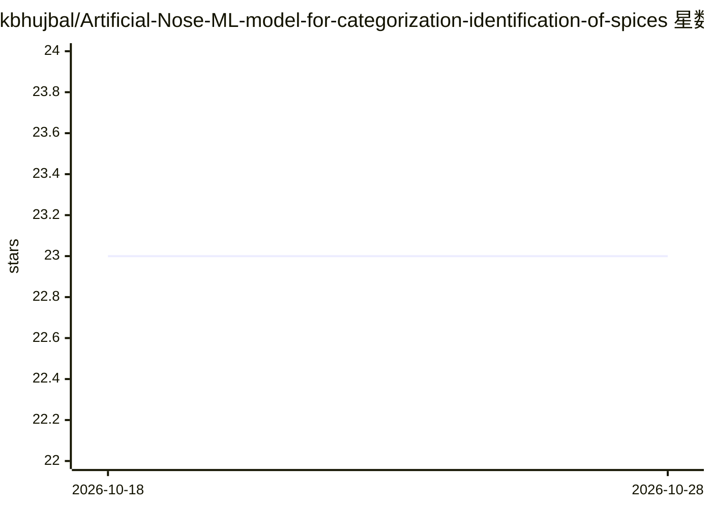

# kbhujbal/Artificial-Nose-ML-model-for-categorization-identification-of-spices

⭐ 23 · Python · 推送 2026-04-19 · [GitHub](https://github.com/kbhujbal/Artificial-Nose-ML-model-for-categorization-identification-of-spices) · [官网](https://ieeexplore.ieee.org/abstract/document/10141407) · 个人维护

**8 通道气体传感器阵列 + 随机森林的香料识别电子鼻**

IEEE 2023 会议论文的实现仓库：用 8 个 MOS 气体传感器（MQ135、TGS 系列）采集气味信号，经 PIC 单片机 10 位 ADC 与串口 USB 传入 PC，再用 Python 训练随机森林（10 棵树）与 MLP 做三分类（肉桂/丁香/肉豆蔻），并复现论文图表（混淆矩阵、特征重要性、算法对比）。README 报告最终测试中随机森林三类均 100%、MLP 约 96.87%-97.38%。支持接入真实硬件采集的 CSV 数据，也提供合成数据路径与 Jupyter 分析笔记本。

## 筛选速览

| 维度 | 判定 | 备注 |
|---|---|---|
| AI 角色 | `ai-native` | 本体是模型或模型工具 |
| 许可风险 | `none` | — |
| 部署形态 | `library` | 以包/库形式分发 |
| 模型依赖 | — | README 未给出锁定关系 |
| 硬件要求 | — | 无带数字的原话,不猜 |
| 安装摩擦 | `low` | 无编译、无系统依赖或容器化 |
| 成熟度 | — | 结构信号不足 |

## 能力要点

- 随机森林与 MLP 两种分类器的对比实现
- 复现论文 Figure 6-8 与 Table I/II 的输出图表
- 定义了真实硬件数据的 CSV 列名格式（8 传感器 + label）
- 提供 Jupyter 交互式分析笔记本

## 适用场景

- 复现论文中的香料分类实验与图表
- 用真实电子鼻硬件数据训练自己的分类器
- 学习传感器阵列 + 机器学习的信号分类流程

## 场景标签

 · 领域:硬件传感/机器学习

## 证据(README 行号)

> L10: An Artificial Nose system that identifies three spices — **Cinnamon**, **Clove**, and **Nutmeg** — using an array o
> L23:              → Python ML Pipeline → Spice Classification

## 星数曲线

2026-10-18 23 → 2026-10-28 23（+0）

---
*卡片 v1 · prompt 1.4 · 生成 2026-10-27 · 置信度 mid · 依据 README sha `eb026b608790` · [字段定义](../../DATASET.md)*
