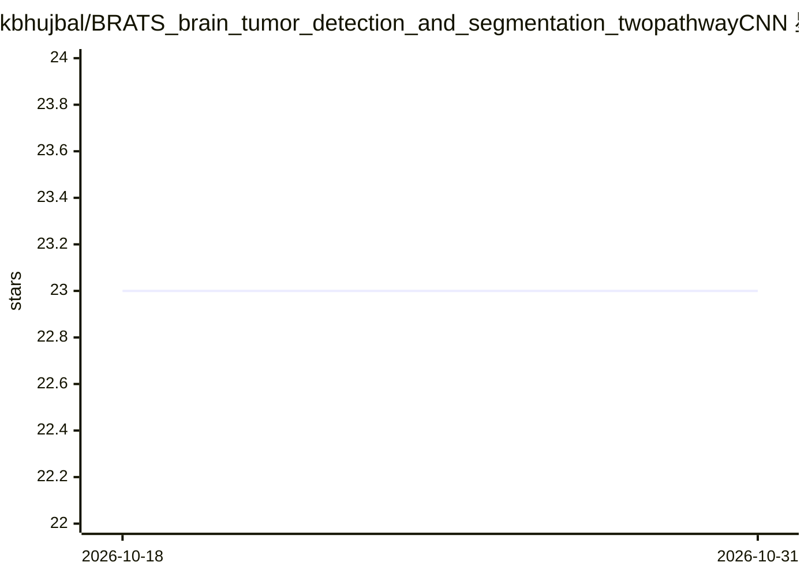

# kbhujbal/BRATS_brain_tumor_detection_and_segmentation_twopathwayCNN

⭐ 23 · Python · MIT · 推送 2026-04-12 · [GitHub](https://github.com/kbhujbal/BRATS_brain_tumor_detection_and_segmentation_twopathwayCNN) · [官网](https://thegrenze.com/index.php?display=page&view=journalabstract&absid=1701&id=8) · 个人维护

**PyTorch 复现双通路 CNN 脑肿瘤 MRI 分割（BraTS 2020）**

论文《Deep Learning based Model for Brain Tumor Detection and Segmentation using BRATS Dataset》的 PyTorch 实现，面向 BraTS 2020 数据集（494 受试者、4 种 MRI 模态）。实现 TwoPathCNN、InputCascadeCNN、LocalCascadeCNN、MFCascadeCNN 四种架构，采用两阶段训练（均衡采样后冻结骨干重训输出层）与全卷积推理实现整片预测。提供训练、评估、预测与测试脚本；需自备 BraTS 2020 数据。README 中 Dice 分数为原论文在 BraTS 2013 上的结果。

## 筛选速览

| 维度 | 判定 | 备注 |
|---|---|---|
| AI 角色 | `ai-native` | 本体是模型或模型工具 |
| 许可风险 | `permissive` | MIT |
| 部署形态 | `library` | 以包/库形式分发 |
| 模型依赖 | — | README 未给出锁定关系 |
| 硬件要求 | — | 无带数字的原话,不猜 |
| 安装摩擦 | `low` | 无编译、无系统依赖或容器化 |
| 成熟度 | — | 结构信号不足 |

## 能力要点

- 双通路架构（7x7 局部 + 13x13 全局）与三种级联变体实现
- 两阶段训练：均衡标签采样后冻结骨干校准概率
- 全卷积推理支持整片单次前向预测
- 提供 train/evaluate/predict/pytest 脚本与 config.yaml

## 适用场景

- 在 BraTS 2020 数据上训练脑肿瘤分割模型
- 复现并对比论文中多种 CNN 架构
- 对新 MRI 数据运行分割预测并可视化

## 场景标签

`目标检测` · 领域:感知与多模态

## 证据(README 行号)

> L3: PyTorch implementation of the paper:
> L10: Adapted for the **BraTS 2020** dataset (494 subjects, 4 MRI modalities).
> L14: The paper proposes a fully automatic brain tumor segmentation method using CNNs tailored to glioblastomas in MRI. K

## 星数曲线

2026-10-18 23 → 2026-10-31 23（+0）

---
*卡片 v1 · prompt 1.4 · 生成 2026-10-27 · 置信度 high · 依据 README sha `127bfe14b832` · [字段定义](../../DATASET.md)*
