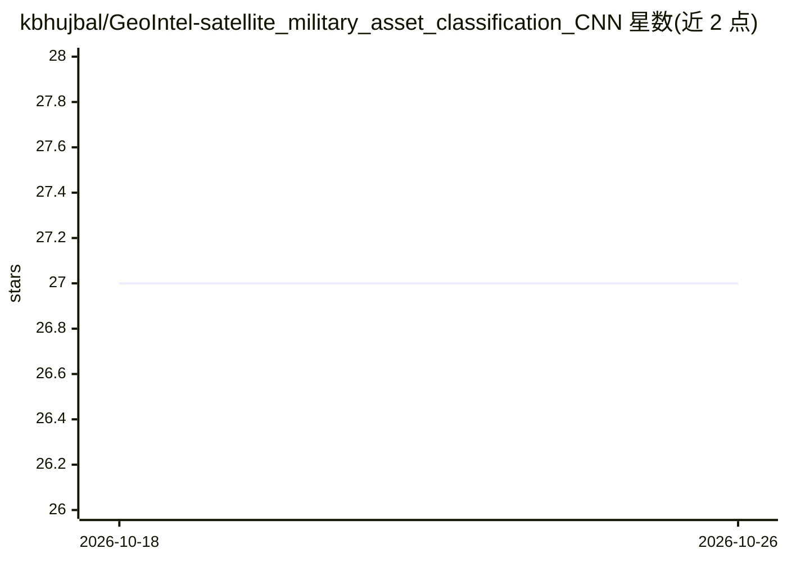

# kbhujbal/GeoIntel-satellite_military_asset_classification_CNN

⭐ 27 · Python · MIT · 推送 2025-12-02 · [GitHub](https://github.com/kbhujbal/GeoIntel-satellite_military_asset_classification_CNN) · 个人维护

**卫星图像军事车辆检测系统：SAHI 切片推理识别小目标**

基于 YOLOv8 与 SAHI（Slicing Aided Hyper Inference）的遥感目标检测系统：将 4000×4000 卫星图像切分为 512×512 重叠切片做全分辨率推理，检测坦克、卡车、货运车等约 20×20 像素的小型军事车辆，输出标注图像、GeoJSON 与含置信度的 JSON 元数据。提供单图、批处理与 SAHI/标准推理对比三种模式，支持 YOLO 格式数据集训练，分类 4 类，模型与切片参数由 config.yaml 配置。以 pip 依赖 + Python 源码运行。

## 筛选速览

| 维度 | 判定 | 备注 |
|---|---|---|
| AI 角色 | `ai-native` | 本体是模型或模型工具 |
| 许可风险 | `permissive` | MIT |
| 部署形态 | `library` | 以包/库形式分发 |
| 模型依赖 | — | README 未给出锁定关系 |
| 硬件要求 | — | 无带数字的原话,不猜 |
| 安装摩擦 | `low` | 无编译、无系统依赖或容器化 |
| 成熟度 | — | 结构信号不足 |

## 能力要点

- SAHI 切片推理检测小目标（512×512 重叠切片）
- 输出标注图像、GeoJSON 与置信度 JSON
- 单图/批处理/SAHI 对标准推理对比三种模式
- 4 类军事车辆（Tank/Truck/Cargo/generic）YOLO 格式训练支持

## 适用场景

- 高分辨率卫星影像中检测小型军用车辆
- 比较切片推理与标准缩放推理的检出差异
- 将检测结果以 GeoJSON 接入 GIS 系统

## 场景标签

`目标检测` · 领域:感知与多模态

## 证据(README 行号)

> L9: Identify small military vehicles (Tanks, Trucks, Cargo) in high-resolution satellite imagery using **Slicing Aided H
> L48: The heart of the system - `src/geointel_eye.py` - uses SAHI's `get_sliced_prediction` to detect small objects:

## 星数曲线

2026-10-18 27 → 2026-10-26 27（+0）

---
*卡片 v1 · prompt 1.4 · 生成 2026-10-26 · 置信度 high · 依据 README sha `cbcddb430122` · [字段定义](../../DATASET.md)*
