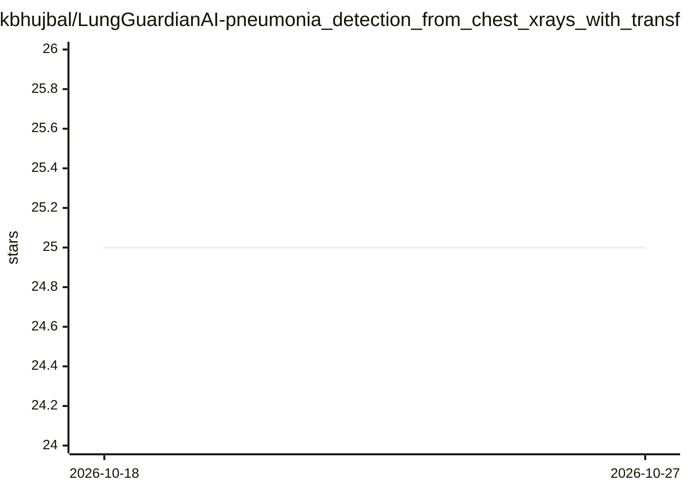

# kbhujbal/LungGuardianAI-pneumonia_detection_from_chest_xrays_with_transfer_learning

⭐ 25 · Python · MIT · 推送 2025-12-03 · [GitHub](https://github.com/kbhujbal/LungGuardianAI-pneumonia_detection_from_chest_xrays_with_transfer_learning) · 个人维护

**胸片肺炎病灶目标检测项目：EfficientNetV2+Faster R-CNN 定位阴影**

面向 RSNA 肺炎检测竞赛的目标检测方案：以 EfficientNetV2-S 为骨干、Faster R-CNN+FPN 为检测头，在胸部 X 光片中以边界框定位肺炎阴影，输出检测而非分类。采用 Focal Loss 处理背景锚框失衡、Weighted Box Fusion 做后处理、Mosaic 等增强与 StratifiedGroupKFold 防止患者跨折泄露。训练需自下载 RSNA 数据集，GPU 训练要求 CUDA 11.0+ 与约 8GB 显存，含混合精度训练。

## 筛选速览

| 维度 | 判定 | 备注 |
|---|---|---|
| AI 角色 | `ai-native` | 本体是模型或模型工具 |
| 许可风险 | `permissive` | MIT |
| 部署形态 | `library` | 以包/库形式分发 |
| 模型依赖 | — | README 未给出锁定关系 |
| 硬件要求 | `gpu-8g` | |
| 安装摩擦 | `medium` | 含编译或系统依赖之一 |
| 成熟度 | — | 结构信号不足 |

## 能力要点

- Faster R-CNN + FPN + EfficientNetV2-S 的边界框检测架构
- Focal Loss、Weighted Box Fusion、Mosaic 增强与 StratifiedGroupKFold 防泄露
- 1024×1024 原生分辨率、混合精度训练配置
- 提供训练、推理与数据管线的代码文件

## 适用场景

- 在 RSNA 数据集上训练肺炎病灶检测模型
- 复现竞赛方案的检测管线与交叉验证策略
- 加载训练权重对胸部 X 光片做推理定位

## 场景标签

 · 领域:医学影像/计算机视觉

## 证据(README 行号)

> L9: This is an **object detection** model, not a classifier. It finds and localizes pneumonia opacities in chest X-rays 
> L22: |Detector|Faster R-CNN + FPN|Multi-scale detection|

## 星数曲线

2026-10-18 25 → 2026-10-27 25（+0）

---
*卡片 v1 · prompt 1.4 · 生成 2026-10-27 · 置信度 mid · 依据 README sha `d1eac19fd736` · [字段定义](../../DATASET.md)*
