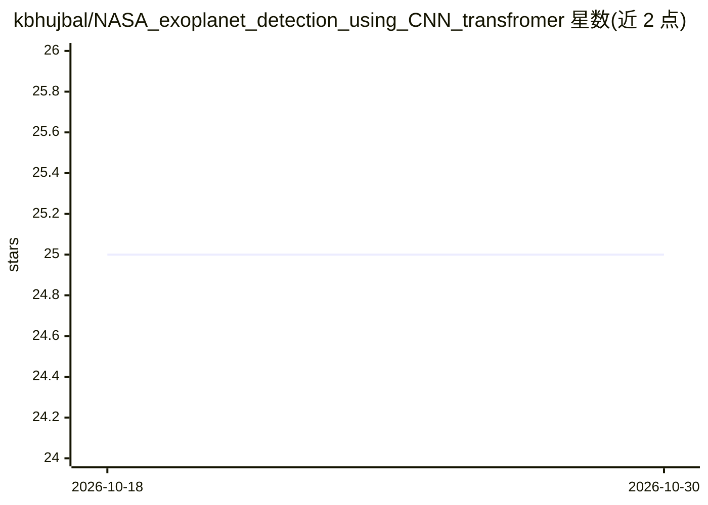

# kbhujbal/NASA_exoplanet_detection_using_CNN_transfromer

⭐ 25 · Python · MIT · 推送 2026-04-26 · [GitHub](https://github.com/kbhujbal/NASA_exoplanet_detection_using_CNN_transfromer) · 个人维护

**混合 CNN-Transformer 检测 Kepler 光变曲线中的系外行星凌星信号**

面向天文学研究者与科研开发者的深度学习管线：将相位折叠的 Kepler 光变曲线输入全局视图 CNN、局部视图 CNN 与 Transformer 编码器三并行分支，经 MLP 头融合分类为确认系外行星或假阳性。训练使用 Focal Loss 处理类别不平衡，Monte Carlo Dropout 输出不确定性并把预测分为高/中/低置信档，Grad-CAM、注意力分析与 SHAP 提供事后解释。提供单命令训练（5 折交叉验证）、评估、单目标推理脚本与完整 notebook。限制：Kaggle KOI 表不含原始光变流量，需自行从 MAST 下载 FITS 或用 lightkurve 注入 flux 列。

## 筛选速览

| 维度 | 判定 | 备注 |
|---|---|---|
| AI 角色 | `ai-native` | 本体是模型或模型工具 |
| 许可风险 | `permissive` | MIT |
| 部署形态 | `None` |  |
| 模型依赖 | — | README 未给出锁定关系 |
| 硬件要求 | — | 无带数字的原话,不猜 |
| 安装摩擦 | `medium` | 含编译或系统依赖之一 |
| 成熟度 | — | 结构信号不足 |

## 能力要点

- 三分支（全局 CNN+局部 CNN+Transformer）融合架构与 Focal Loss 训练
- Monte Carlo Dropout 不确定性估计，低置信预测转人工审核
- Grad-CAM/注意力/SHAP 三种事后可解释性方法
- 单命令完成预处理、SMOTE、数据增强与 5 折交叉验证

## 适用场景

- 自动甄别 Kepler KOI 候选为系外行星或假阳性
- 审查每个分类判断背后的证据（Grad-CAM/SHAP）
- 复现端到端训练与基线对比实验

## 场景标签

`科研工具` · 领域:学习与行业

## 证据(README 行号)

> L3: A deep learning pipeline for automated classification of Kepler Objects of Interest as confirmed exoplanets or false
> L7: The automated vetting of exoplanet transit signals from photometric survey data presents a significant classificatio

## 星数曲线

2026-10-18 25 → 2026-10-30 25（+0）

---
*卡片 v1 · prompt 1.4 · 生成 2026-10-27 · 置信度 high · 依据 README sha `2932688b3de2` · [字段定义](../../DATASET.md)*
