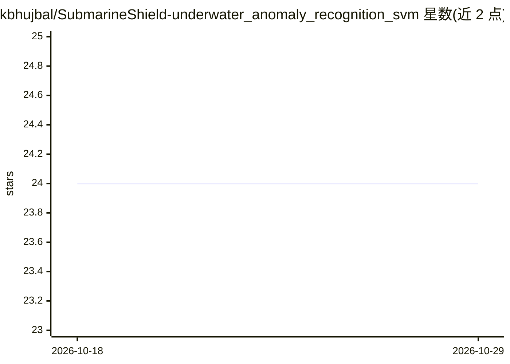

# kbhujbal/SubmarineShield-underwater_anomaly_recognition_svm

⭐ 24 · Python · MIT · 推送 2025-11-24 · [GitHub](https://github.com/kbhujbal/SubmarineShield-underwater_anomaly_recognition_svm) · 个人维护

**用 SVM 对声呐信号分类识别水雷与岩石的 ML 系统**

基于 scikit-learn 的二分类系统：读取声呐 60 个频段能量特征，通过 StandardScaler + SVC 的 Pipeline 区分水雷与岩石，训练脚本执行数据加载、标签编码、80/20 分层切分、5 折交叉验证的 GridSearchCV 调参（C/核函数/gamma），并输出水雷检测率、误报率等指标，模型以 joblib 持久化。数据集为 UCI Sonar（208 样本），需手动下载到 data/raw/ 目录后运行 python src/train.py。配置集中在 config.py，随机种子固定为 42。

## 筛选速览

| 维度 | 判定 | 备注 |
|---|---|---|
| AI 角色 | `ai-native` | 本体是模型或模型工具 |
| 许可风险 | `permissive` | MIT |
| 部署形态 | `None` |  |
| 模型依赖 | — | README 未给出锁定关系 |
| 硬件要求 | — | 无带数字的原话,不猜 |
| 安装摩擦 | `low` | 无编译、无系统依赖或容器化 |
| 成熟度 | — | 结构信号不足 |

## 能力要点

- StandardScaler + SVC 的 sklearn Pipeline 二分类
- GridSearchCV 对 C/Kernel/Gamma 做 5 折交叉验证调参
- 输出 Mine Detection Rate、False Alarm Rate 等任务指标
- 随机种子固定（42），模型含预处理一并持久化为 joblib

## 适用场景

- 我想训练一个区分声呐信号中水雷与岩石的分类器
- 我需要一套可复现的 sklearn Pipeline 与调参模板
- 我想在 UCI Sonar 数据集上做小样本高维分类实验

## 场景标签

 · 领域:机器学习/国防探测

## 证据(README 行号)

> L7: This project implements a binary classification system to distinguish between underwater rocks and mines based on so
> L48: 2. **Support Vector Classifier (SVC)**: Binary classification model

## 星数曲线

2026-10-18 24 → 2026-10-29 24（+0）

---
*卡片 v1 · prompt 1.4 · 生成 2026-10-27 · 置信度 high · 依据 README sha `125cfda2c1f7` · [字段定义](../../DATASET.md)*
