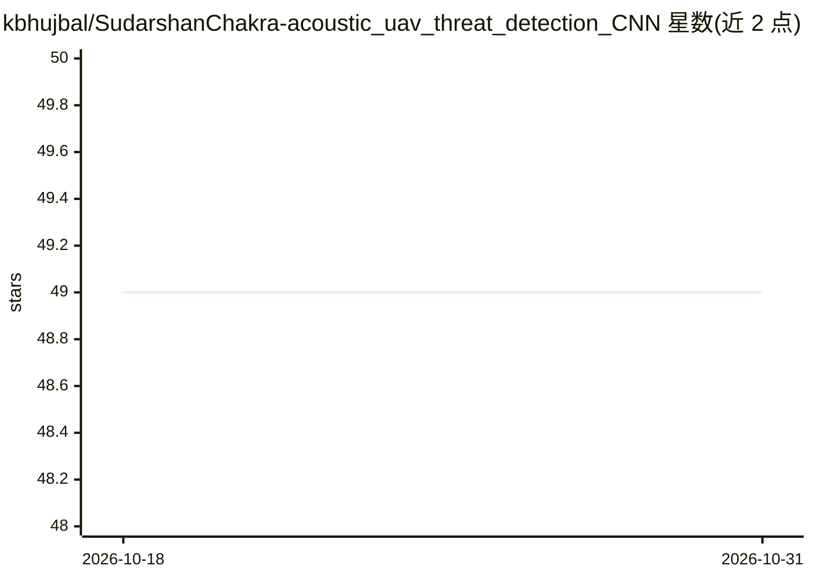

# kbhujbal/SudarshanChakra-acoustic_uav_threat_detection_CNN

⭐ 49 · Python · NOASSERTION · 推送 2025-11-24 · [GitHub](https://github.com/kbhujbal/SudarshanChakra-acoustic_uav_threat_detection_CNN) · 个人维护

**声学无人机检测系统：用 CNN 识别无人机音频特征**

基于深度学习的声学监测系统，面向地面防御单位：将原始音频转换为 Mel 频谱图，用自定义 4 层 CNN（约 50 万参数）做二分类，判定为威胁（无人机）或安全（背景音）。自动克隆并准备 DroneAudioDataset，训练带早停与最优模型检查点；默认 0.4 置信度阈值偏向高召回（减少漏检）。提供推理 API 与 CLI，以 Python 源码运行。

## 筛选速览

| 维度 | 判定 | 备注 |
|---|---|---|
| AI 角色 | `ai-native` | 本体是模型或模型工具 |
| 许可风险 | `none` | NOASSERTION |
| 部署形态 | `None` |  |
| 模型依赖 | — | README 未给出锁定关系 |
| 硬件要求 | — | 无带数字的原话,不猜 |
| 安装摩擦 | `low` | 无编译、无系统依赖或容器化 |
| 成熟度 | — | 结构信号不足 |

## 能力要点

- 音频转 Mel 频谱图后由 4 层 CNN 分类，约 50 万参数
- 自动下载并准备 DroneAudioDataset，早停与模型检查点
- 默认 0.4 置信度阈值，偏向高召回以减少漏检
- 提供推理 API（ThreatDetector）与 CLI

## 适用场景

- 实时监听环境音频并检测无人机螺旋桨声学特征
- 防御场景下对音频做威胁/安全二分类判断
- 对单个音频文件执行无人机检测推理

## 场景标签

 · 领域:声学监测/防御技术

## 证据(README 行号)

> L5: A production-grade deep learning system for detecting drone/UAV acoustic signatures using Mel-Spectrogram analysis a
> L16: - **Audio-to-Vision Pipeline**: Converts raw audio waveforms to Mel-Spectrograms for CNN analysis

## 星数曲线

2026-10-18 49 → 2026-10-31 49（+0）

---
*卡片 v1 · prompt 1.4 · 生成 2026-10-24 · 置信度 high · 依据 README sha `cd6f9bd8f46a` · [字段定义](../../DATASET.md)*
