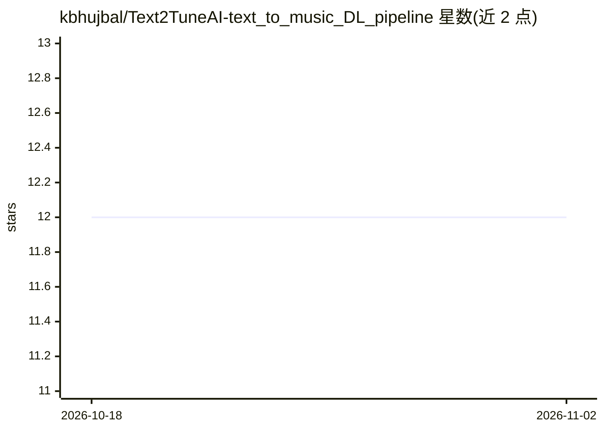

# kbhujbal/Text2TuneAI-text_to_music_DL_pipeline

⭐ 12 · Python · MIT · 推送 2025-11-24 · [GitHub](https://github.com/kbhujbal/Text2TuneAI-text_to_music_DL_pipeline) · 个人维护

**从歌词生成情感感知旋律的深度学习管线**

基于 PyTorch 的文本到音乐生成系统：用 BERT（110M 参数）编码歌词的语义与情感特征，8 层 Transformer 解码器（45M 参数）自回归生成旋律，支持 temperature/top-k/top-p 采样，输出 MIDI 与音频。训练采用 DALI（5,358 首对齐歌曲）与 Lakh MIDI（18 万+ 文件）混合数据集，损失函数含重构、连贯性、情感与节奏多目标。提供 CLI 与 Python API，训练需 GPU（RTX 3090 实测 18GB 显存）。

## 筛选速览

| 维度 | 判定 | 备注 |
|---|---|---|
| AI 角色 | `ai-native` | 本体是模型或模型工具 |
| 许可风险 | `permissive` | MIT |
| 部署形态 | `library` | 以包/库形式分发 |
| 模型依赖 | — | README 未给出锁定关系 |
| 硬件要求 | — | 无带数字的原话,不猜 |
| 安装摩擦 | `low` | 无编译、无系统依赖或容器化 |
| 成熟度 | — | 结构信号不足 |

## 能力要点

- BERT 文本编码 + Transformer 自回归解码生成旋律
- 情感感知生成与多目标损失（重构/连贯/情感/节奏）
- DALI + Lakh MIDI 混合数据集训练
- MIDI/音频导出，CLI 与 Python API 双入口

## 适用场景

- 输入歌词生成匹配情感语境的旋律
- 在自己的数据集上训练定制文本到音乐模型
- 调节 tempo/temperature 等参数控制生成风格

## 场景标签

 · 领域:AI 音乐生成

## 证据(README 行号)

> L9: **Text2TuneAI** generates musical melodies based on the semantic meaning and emotional context of input lyrics. It u
> L14: **User provides lyrics → AI generates contextual melody**
> L42: python main.py generate \

## 星数曲线

2026-10-18 12 → 2026-11-02 12（+0）

---
*卡片 v1 · prompt 1.4 · 生成 2026-11-01 · 置信度 high · 依据 README sha `e9ce8128dea0` · [字段定义](../../DATASET.md)*
