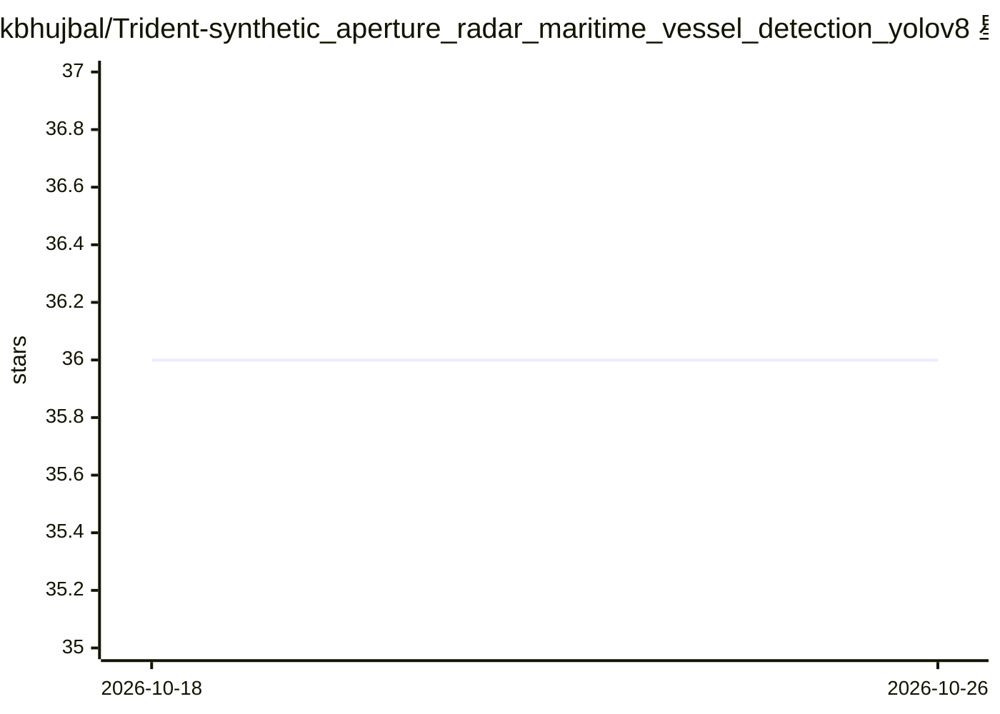

# kbhujbal/Trident-synthetic_aperture_radar_maritime_vessel_detection_yolov8

⭐ 36 · Python · MIT · 推送 2025-12-04 · [GitHub](https://github.com/kbhujbal/Trident-synthetic_aperture_radar_maritime_vessel_detection_yolov8) · 个人维护

**检测 SAR 卫星影像中船舶的系统：Lee 滤波+YOLOv8-OBB**

面向 SAR（合成孔径雷达）图像的船舶检测系统：先用 Lee 滤波去除雷达特有的乘性斑点噪声并保留船舶边缘，再用 YOLOv8-OBB 旋转边界框检测任意方向的船只，输出四角点坐标、中心、宽高、角度与置信度。数据集使用 SSDD（训练 4,716 张/验证 1,346 张，COCO JSON 转 YOLO OBB），通过 Kaggle API 下载，提供训练与推理脚本及 Python API（SARPreprocessor、SARShipDetector），支持 n/s/m/l/x 五种模型规格，配置经 config.yaml 定制。

## 筛选速览

| 维度 | 判定 | 备注 |
|---|---|---|
| AI 角色 | `ai-native` | 本体是模型或模型工具 |
| 许可风险 | `permissive` | MIT |
| 部署形态 | `None` |  |
| 模型依赖 | — | README 未给出锁定关系 |
| 硬件要求 | — | 无带数字的原话,不猜 |
| 安装摩擦 | `low` | 无编译、无系统依赖或容器化 |
| 成熟度 | — | 结构信号不足 |

## 能力要点

- Lee 滤波去除 SAR 乘性斑点噪声并保留船舶边缘
- YOLOv8-OBB 旋转边界框检测任意方向船只（n~x 五种规格）
- SSDD 数据集下载与 YOLO OBB 格式转换脚本
- Python API：SARPreprocessor 与 SARShipDetector

## 适用场景

- 在 SAR 卫星影像中定位并输出船舶的旋转框坐标
- 训练自己的 SAR 船舶检测模型（基于 SSDD 数据集）
- 海上监视场景下对雷达图像做批量的船只检测

## 场景标签

`目标检测` `图像视频处理` · 领域:感知与多模态

## 证据(README 行号)

> L3: A production-grade maritime surveillance system for detecting ships in Synthetic Aperture Radar (SAR) imagery using 
> L10: - **Lee Speckle Filter**: Remove radar-specific multiplicative noise
> L11: - **YOLOv8-OBB**: Detect ships with rotated bounding boxes (ships are rarely horizontal)

## 星数曲线

2026-10-18 36 → 2026-10-26 36（+0）

---
*卡片 v1 · prompt 1.4 · 生成 2026-10-25 · 置信度 high · 依据 README sha `e74a87c40189` · [字段定义](../../DATASET.md)*
