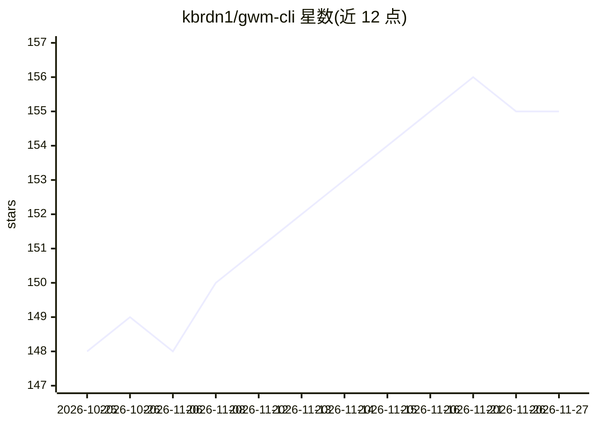

# kbrdn1/gwm-cli

⭐ 155 · Rust · Apache-2.0 · 推送 2026-11-26 · [GitHub](https://github.com/kbrdn1/gwm-cli) · [官网](https://gwm.kbrdn.dev) · 个人维护

**面向开发者的终端 Git worktree 管理器（CLI+TUI）**

单个二进制的 Git worktree 管理工具，Rust 编写并内置 libgit2，无需单独的 worktree 包装工具；创建 worktree 时复制指定文件、运行预设的 setup 命令、关联 GitHub issue。提供 ratatui TUI、JSON-RPC daemon、statusline 集成、undo/history 恢复、批量清理、多仓 workspace 模式与六阶段生命周期 hooks。从磁盘产物检测 Claude Code、Codex、opencode、Mistral Vibe 的会话并在表格中显示；git 本身仍需在 PATH 上以执行部分操作。

## 筛选速览

| 维度 | 判定 | 备注 |
|---|---|---|
| AI 角色 | `ai-enhanced` | 去掉 AI 部分产品仍成立 |
| 许可风险 | `permissive` | Apache-2.0 |
| 部署形态 | `self-host` | docker 或自建部署 |
| 模型依赖 | — | README 未给出锁定关系 |
| 硬件要求 | — | 无带数字的原话,不猜 |
| 安装摩擦 | `low` | 无编译、无系统依赖或容器化 |
| 成熟度 | — | 结构信号不足 |

## 能力要点

- 单一二进制管理多仓库 worktree，原生 libgit2 操作无需 shell 调用
- 检测 Claude Code/Codex/opencode/Mistral Vibe 会话并以 AGENT 列显示
- JSON-RPC daemon 与 statusline、--format=json 机器接口（SemVer 冻结）
- 六阶段生命周期 hooks 与 deny-list 正则防止复制敏感文件

## 适用场景

- 并行开发多个分支且各自带独立环境
- 同时跟进多个 AI agent 在哪些 worktree 工作
- 团队按栈预设统一 worktree 初始化流程

## 场景标签

 · 领域:开发者工具/git 工具

## 证据(README 行号)

> L3:  gwm: git worktree manager, a CLI + TUI in Rust. One binary, every worktree, setup already done.
> L21: Written in Rust on vendored `libgit2`, so worktree operations are native rather than shelled out, and there is no `
> L27: - **It knows which AI agent works where.** Sessions from Claude Code, Codex, opencode and Mistral Vibe are detected

## 星数曲线

2026-10-25 148 → 2026-11-27 155（+7）

---
*卡片 v1 · prompt 1.4 · 生成 2026-11-27 · 置信度 mid · 依据 README sha `4e02df37fee6` · [字段定义](../../DATASET.md)*
