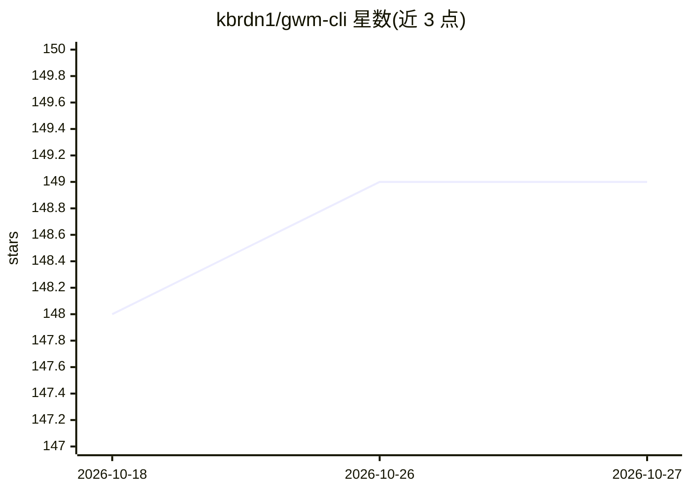

# kbrdn1/gwm-cli

⭐ 149 · Rust · Apache-2.0 · 推送 2026-10-26 · [GitHub](https://github.com/kbrdn1/gwm-cli) · [官网](https://gwm.kbrdn.dev) · 个人维护

**给开发者的 git worktree 管理 CLI/TUI，检测 AI agent 会话归属**

Rust 编写的单二进制 git worktree 管理器，基于 vendored libgit2 提供原生 worktree 操作，含 ratatui TUI。功能包括：创建 worktree 时执行文件复制、setup 命令与生命周期钩子；GitHub issue 自动关联、PR 拉取与评审；JSON 输出与 JSON-RPC daemon；多仓库 workspace 模式；撤销删除、TOFU 信任账本与安全清理。AI 相关能力为检测 Claude Code、Codex、opencode、Mistral Vibe 在各 worktree 的会话并在表格与状态行中显示。安装支持 Cargo、Homebrew、Scoop、Nix、.deb/.rpm 等渠道。

## 筛选速览

| 维度 | 判定 | 备注 |
|---|---|---|
| AI 角色 | `ai-enhanced` | 去掉 AI 部分产品仍成立 |
| 许可风险 | `permissive` | Apache-2.0 |
| 部署形态 | `self-host` | docker 或自建部署 |
| 模型依赖 | — | README 未给出锁定关系 |
| 硬件要求 | — | 无带数字的原话,不猜 |
| 安装摩擦 | `low` | 无编译、无系统依赖或容器化 |
| 成熟度 | — | 结构信号不足 |

## 能力要点

- 基于 vendored libgit2 的原生 worktree 操作，单二进制无需额外 git 包装器
- 检测 Claude Code/Codex/opencode/Mistral Vibe 会话并显示各 worktree 的 agent 归属
- 创建时执行文件复制、deny-list 正则与 6 个生命周期钩子阶段，支持 Laravel/Symfony/Node/Rust/Go/Python 预设
- 提供 JSON 输出、JSON-RPC daemon 与 statusline 客户端供编辑器/状态栏接入

## 适用场景

- 在终端统一创建、浏览和清理多个 git worktree
- 并行运行多个 AI coding agent 时查看哪个 agent 在哪个分支工作
- 为每个新 worktree 自动执行项目环境配置与文件复制
- 跨多个仓库的 workspace 模式下批量管理工作区

## 场景标签

 · 领域:开发者工具/版本控制

## 证据(README 行号)

> L3:  gwm: git worktree manager, a CLI + TUI in Rust. One binary, every worktree, setup already done.
> L17: `gwm create feat 42 user-auth` branches it, places it on disk, copies the files you told it to, runs the setup comm
> L27: - **It knows which AI agent works where.** Sessions from Claude Code, Codex, opencode and Mistral Vibe are detected

## 星数曲线

2026-10-18 148 → 2026-10-27 149（+1）

---
*卡片 v1 · prompt 1.4 · 生成 2026-10-22 · 置信度 mid · 依据 README sha `ef33f9b092c2` · [字段定义](../../DATASET.md)*
