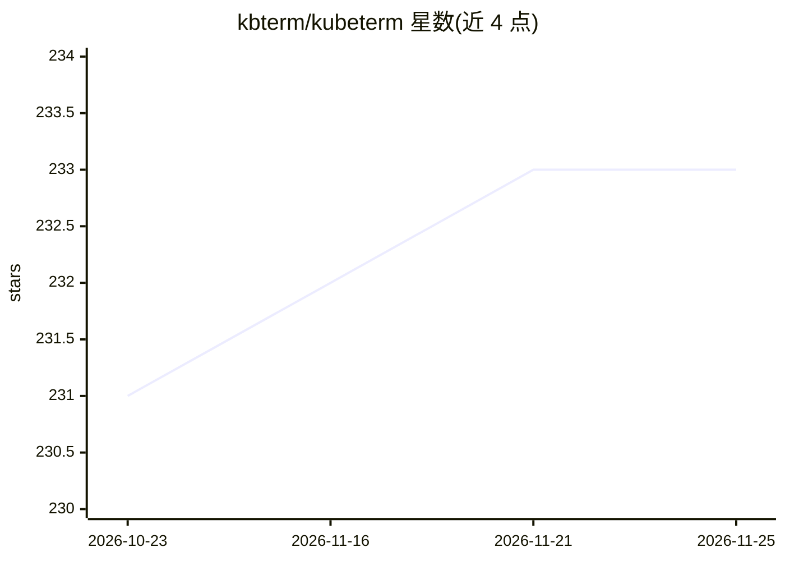

# kbterm/kubeterm

⭐ 233 · 推送 2026-11-20 · [GitHub](https://github.com/kbterm/kubeterm) · [官网](https://www.kubeterm.com) · 组织维护

**桌面与移动端 Kubernetes 图形管理工具，内置运维 AI 助手**

Kubeterm 是本地运行的 Kubernetes 集群图形管理应用，无需向集群内安装组件。功能覆盖 kubeconfig 自动加载与云账号导入（GCP/Azure/AWS 凭证）、OIDC 认证、资源查看与增删改、临时容器调试、日志查看、文件传输、端口转发、Helm 发布管理、Argo CD/Flux 监控及 Prometheus 历史指标。内置 AI Agent 结合当前集群上下文辅助排障与运维，变更类操作需用户批准。提供 iOS/Android 及 macOS/Windows/Linux 安装包；应用本体不开源，仓库仅承载 issue、发布与文档。

## 筛选速览

| 维度 | 判定 | 备注 |
|---|---|---|
| AI 角色 | `ai-enhanced` | 去掉 AI 部分产品仍成立 |
| 许可风险 | `none` | — |
| 部署形态 | `library` | 以包/库形式分发 |
| 模型依赖 | — | README 未给出锁定关系 |
| 硬件要求 | — | 无带数字的原话,不猜 |
| 安装摩擦 | `low` | 无编译、无系统依赖或容器化 |
| 成熟度 | — | 结构信号不足 |

## 能力要点

- 内置 AI 助手，携带集群/资源上下文辅助排障，变更操作需显式批准
- 零配置读取 kubeconfig，支持 GCP/Azure 云账号登录导入集群
- Helm 发布管理、Argo CD/Flux CD 监控与 Prometheus 集成
- 桌面与移动端跨平台，数据本地存储、无遥测

## 适用场景

- 在桌面或手机上查看和管理 Kubernetes 集群资源
- 用 AI 助手排查集群问题并执行运维操作
- 管理 Helm 发布和 GitOps（Argo CD/Flux）应用状态

## 场景标签

`AI 助手` · 领域:对话与助手

## 证据(README 行号)

> L9: Kubeterm is a graphical management tool for Kubernetes clusters.
> L24: - **AI Agent:**
> L102: The Kubeterm application is not open source.

## 星数曲线

2026-10-23 231 → 2026-11-25 233（+2）

---
*卡片 v1 · prompt 1.4 · 生成 2026-11-25 · 置信度 high · 依据 README sha `9ca9397f8d3a` · [字段定义](../../DATASET.md)*
