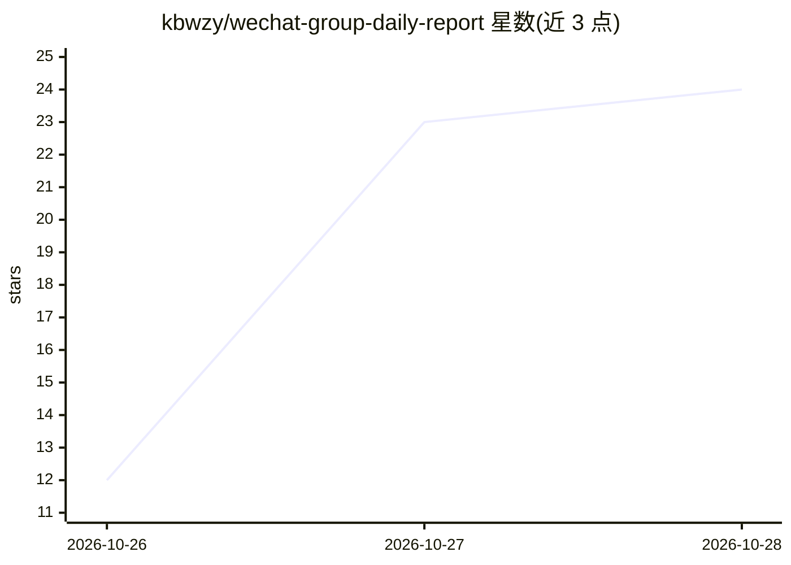

# kbwzy/wechat-group-daily-report

⭐ 24 · Python · MIT · 推送 2026-10-24 · [GitHub](https://github.com/kbwzy/wechat-group-daily-report) · 个人维护 · 中文 README

**把微信群聊一天生成可核查的图文日报的 Agent 技能**

以 Claude Code/Codex Agent Skill 形式提供的微信群日报生成器：输入群名与时间窗，经 prepare 切片清洗、Agent 写 editorial.json、validate 校验、render 输出 PNG/HTML/Markdown 三种格式。核心机制是证据绑定——每条事实须挂真实消息 ID，伪造或跨群 ID 被校验器拒绝；模型只写 JSON 不碰 HTML，产物标注 semantic_truth: not-verified。只读微信，实时取数需同级安装 wechat-intelligence-hub；标准库部分可离线运行，58 项测试不依赖第三方包。

## 筛选速览

| 维度 | 判定 | 备注 |
|---|---|---|
| AI 角色 | `ai-native` | 本体是模型或模型工具 |
| 许可风险 | `permissive` | MIT |
| 部署形态 | `library` | 以包/库形式分发 |
| 模型依赖 | — | README 未给出锁定关系 |
| 硬件要求 | — | 无带数字的原话,不猜 |
| 安装摩擦 | `low` | 无编译、无系统依赖或容器化 |
| 成熟度 | — | 结构信号不足 |

## 能力要点

- 证据绑定：每条事实挂真实消息 ID，伪造/跨群 ID 被拒绝
- 三段分工：程序管事实、模型管表达（只写 JSON）、模板管版式
- PNG 依赖缺失时如实标注 partial，不假装成功
- 编辑子进程跑在 restricted 模式，只给 Read/Write 两个工具

## 适用场景

- 每天定时把某个微信群生成一张可核查的图文日报
- 离线用仓库自带合成数据复现示例日报
- 回顾群里谁提问、谁反驳、哪些讨论值得跟进

## 场景标签

`AI 写作` · 领域:内容生成

## 证据(README 行号)

> L5:  把你的微信群聊变成一张能读懂、可核查的图文日报。
> L29:                      Agent 语义编辑
> L33: 三件事分开做，各管一段：**程序管事实**（切片、清洗、统计、抽链接、校验引用），**模型管表达**（标题、关键原话、判断），**模板管版式**（模型只写 JSON，碰不到 HTML）。

## 星数曲线

2026-10-26 12 → 2026-10-28 24（+12）

---
*卡片 v1 · prompt 1.4 · 生成 2026-10-27 · 置信度 mid · 依据 README sha `db64d2a46f87` · [字段定义](../../DATASET.md)*
