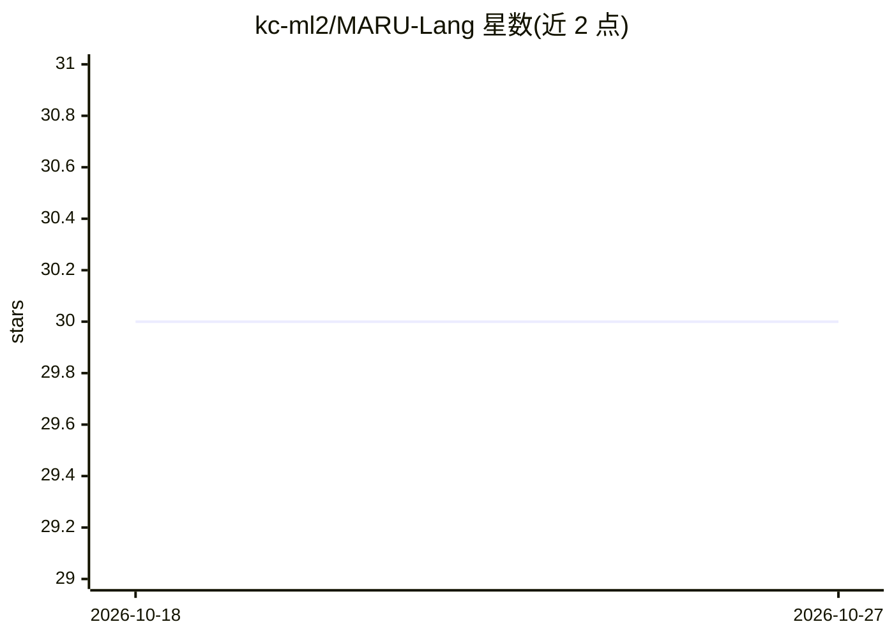

# kc-ml2/MARU-Lang

⭐ 30 · Python · MIT · 推送 2026-10-12 · [GitHub](https://github.com/kc-ml2/MARU-Lang) · 组织维护 · 中文 README

**面向企业环境的开源 RAG 聊天机器人引擎**

基于 FastAPI 与 LangGraph 构建的企业级 RAG 聊天机器人引擎，包含摄入管道（多格式文档解析，含韩文 HWP/HWPX，经 KorDoc MCP 服务器）与聊天管道（搜索路由、自我纠错检索、记忆回写）。内置认证（SMTP OTP、角色层级）、团队 N:N 权限与按消息限定文档搜索范围、审计日志。可选 ARQ+Redis 任务队列与共享 Chroma 向量库横向扩展；LLM 通过 OpenAI 兼容接口配置。

## 筛选速览

| 维度 | 判定 | 备注 |
|---|---|---|
| AI 角色 | `ai-ecosystem` | LLM/agent 周边工具 |
| 许可风险 | `permissive` | MIT |
| 部署形态 | `self-host` | docker 或自建部署 |
| 模型依赖 | local-ok | 支持本地模型 |
| 硬件要求 | — | 无带数字的原话,不猜 |
| 安装摩擦 | `low` | 无编译、无系统依赖或容器化 |
| 成熟度 | — | 结构信号不足 |

## 能力要点

- 摄入管道支持 PDF/DOCX/XLSX 等格式及韩文 HWP/HWPX（KorDoc MCP）
- 聊天管道含搜索路由、检索充分性评估重试与可选重排序
- 内置认证、团队 N:N 权限与按团队的文档搜索范围限定
- 可选 ARQ+Redis 任务队列与共享 Chroma 服务器扩展模式

## 适用场景

- 企业内基于现有文档与权限体系部署问答机器人
- 按团队隔离检索范围并留痕审计的合规问答场景
- 处理含韩文 HWP/HWPX 格式的企业文档知识库

## 场景标签

`聊天机器人` `RAG` `文档解析` · 领域:对话与助手

## 证据(README 行号)

> L5: **MARU** is an open-source **RAG (Retrieval-Augmented Generation) chatbot engine** built for **enterprise environmen
> L26: - **RAG with self-correction** — intent rewrite → keyword extraction → retrieval → sufficiency evaluation with retr
> L93: # --- LLM (OpenAI-compatible servers like vLLM work via the openai provider) ---

## 星数曲线

2026-10-18 30 → 2026-10-27 30（+0）

---
*卡片 v1 · prompt 1.4 · 生成 2026-10-26 · 置信度 mid · 依据 README sha `c03f5d707250` · [字段定义](../../DATASET.md)*
