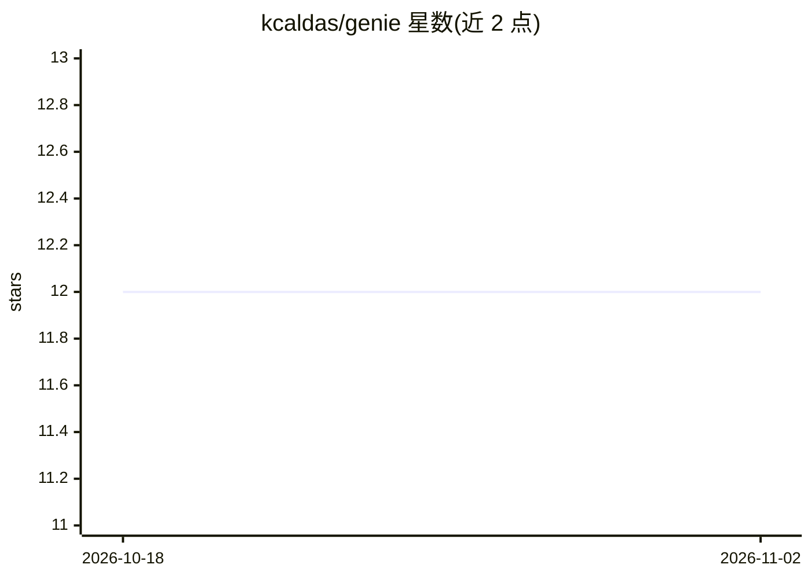

# kcaldas/genie

⭐ 12 · Go · MIT · 推送 2026-10-23 · [GitHub](https://github.com/kcaldas/genie) · 个人维护

**命令行 AI 助手：在终端进行问答、代码审查与解释**

用 Go 编写的终端 AI 助手，提供 CLI 单次问答、Unix 管道（如 git diff | genie ask）与交互式 TUI 三种模式。默认接入 Gemini API，可通过环境变量切换 OpenAI、Anthropic、DeepSeek 提供商，也支持本地 Ollama 与 LM Studio（无需 API key）。支持按角色（engineer、product-owner 等）切换 persona，每个 persona 可在 prompt.yaml 中固定模型与提供商，TUI 内可运行时切换。安装途径含 Homebrew、二进制下载、Docker 与 go install。README 标注为 Beta。

## 筛选速览

| 维度 | 判定 | 备注 |
|---|---|---|
| AI 角色 | `ai-native` | 本体是模型或模型工具 |
| 许可风险 | `permissive` | MIT |
| 部署形态 | `self-host` | docker 或自建部署 |
| 模型依赖 | local-ok | 支持本地模型 |
| 硬件要求 | — | 无带数字的原话,不猜 |
| 安装摩擦 | `low` | 无编译、无系统依赖或容器化 |
| 成熟度 | `idea` | |

## 能力要点

- CLI、Unix 管道与交互式 TUI 三种使用模式
- 支持 Gemini/OpenAI/Anthropic/DeepSeek/Ollama/LM Studio 多提供商切换
- persona 系统可按角色固定模型与提供商
- 提供 Homebrew、二进制、Docker、go install 四种安装方式

## 适用场景

- 在终端直接向 AI 提问、总结文件或解释代码
- 通过管道将 git diff、日志等命令输出交给 AI 处理
- 接入本地 Ollama/LM Studio 模型，免 API key 使用

## 场景标签

`AI 助手` `代码审查` · 领域:编码与开发

## 证据(README 行号)

> L8: Transform your terminal into an AI-powered workspace. Born from a developer's need for control and transparency in A
> L50: genie ask "hello world"              # CLI mode
> L52: genie                                # Interactive TUI mode

## 星数曲线

2026-10-18 12 → 2026-11-02 12（+0）

---
*卡片 v1 · prompt 1.4 · 生成 2026-11-01 · 置信度 high · 依据 README sha `90eccdb02c66` · [字段定义](../../DATASET.md)*
