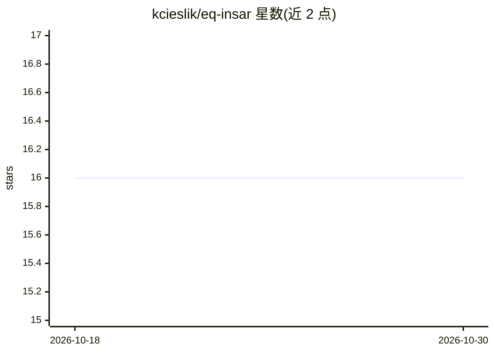

# kcieslik/eq-insar

⭐ 16 · Python · MIT · 推送 2026-06-08 · [GitHub](https://github.com/kcieslik/eq-insar) · 个人维护

**为 ML 训练生成物理仿真的地震 InSAR 形变数据的 Python 库**

基于弹性半空间正演模型（Davis 1986），从震源参数（震级、strike/dip/rake、深度）生成合成的 InSAR 干涉图：包括缠绕相位、解缠相位、LOS 位移与分割掩膜；内置 9 颗真实卫星参数（Sentinel-1、ALOS-2 等），默认叠加幂律大气噪声（Kolmogorov β=5/3），支持 seed 复现。面向做机器学习/深度学习训练的地震学与遥感研究者，核心计算仅依赖 NumPy，可选导出 GeoTIFF/NetCDF，提供单帧、时间序列与批量生成 API 及 Colab 示例。

## 筛选速览

| 维度 | 判定 | 备注 |
|---|---|---|
| AI 角色 | `ai-ecosystem` | LLM/agent 周边工具 |
| 许可风险 | `permissive` | MIT |
| 部署形态 | `library` | 以包/库形式分发 |
| 模型依赖 | — | README 未给出锁定关系 |
| 硬件要求 | — | 无带数字的原话,不猜 |
| 安装摩擦 | `low` | 无编译、无系统依赖或容器化 |
| 成熟度 | — | 结构信号不足 |

## 能力要点

- 弹性半空间正演模型生成地震形变干涉图，非手工构造
- 内置 9 颗真实卫星参数（Sentinel-1/ALOS-2/NISAR 等）
- 输出缠绕/解缠相位、LOS 位移与分割掩膜，含空间相关幂律噪声
- 支持 seed 复现与批量生成（generate_training_batch），核心仅依赖 NumPy

## 适用场景

- 为形变分割/检测模型批量生成带标签的训练数据
- 对比 C/L/X 波长对条纹密度的影响做算法验证
- 生成可控参数的合成干涉图测试 InSAR 处理流程

## 场景标签

 · 领域:地球物理/遥感

## 证据(README 行号)

> L3: **Generate synthetic earthquake InSAR data in minutes.**
> L33: - **ML training data on demand** — generate thousands of labelled interferograms with one function call
> L57: |earthquake_deformation_segmentation_unet.ipynb|**U-Net segmentation quickstart** — generate synthetic data, train,

## 星数曲线

2026-10-18 16 → 2026-10-30 16（+0）

---
*卡片 v1 · prompt 1.4 · 生成 2026-10-30 · 置信度 high · 依据 README sha `f5d8b44cfddf` · [字段定义](../../DATASET.md)*
