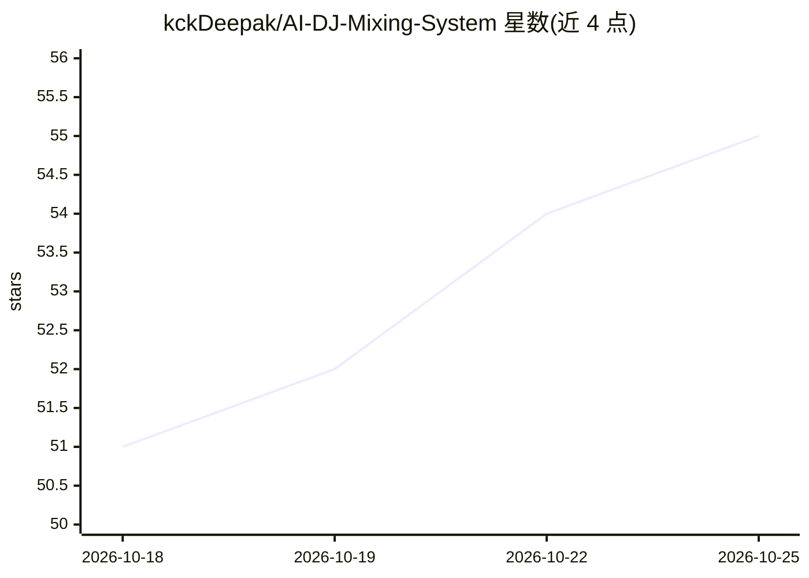

# kckDeepak/AI-DJ-Mixing-System

⭐ 55 · Python · MIT · 推送 2026-02-03 · [GitHub](https://github.com/kckDeepak/AI-DJ-Mixing-System) · 个人维护

**用自然语言 prompt 从本地 MP3 生成 DJ 混音的 AI 管线**

面向个人用户的 Python 混音管线：用自然语言描述需求，系统经 5 阶段处理——OpenAI GPT-4o 选曲、librosa 检测 BPM/能量、OpenAI Whisper API 检测人声与结构、生成含 Camelot 调性和谐与乐句对齐的混音计划、最终输出 mix.mp3 与 JSON setlist/计划文件。支持 crossfade、EQ sweep、echo 过渡、渐进速度同步等 10 种 DJ 技法。运行需 Python 3.8+、FFmpeg 与 OpenAI API key，分析结果缓存在 notes/ 目录供复用。

## 筛选速览

| 维度 | 判定 | 备注 |
|---|---|---|
| AI 角色 | `ai-native` | 本体是模型或模型工具 |
| 许可风险 | `permissive` | MIT |
| 部署形态 | `self-host` | docker 或自建部署 |
| 模型依赖 | — | README 未给出锁定关系 |
| 硬件要求 | — | 无带数字的原话,不猜 |
| 安装摩擦 | `low` | 无编译、无系统依赖或容器化 |
| 成熟度 | — | 结构信号不足 |

## 能力要点

- 自然语言 prompt 驱动 GPT-4o 选曲与 3 个候选过渡点检测
- librosa 本地 BPM/能量检测，Whisper API 检测人声与乐句边界
- Camelot Wheel 调性和谐、8 小节乐句对齐、4-16 秒动态重叠
- 输出 mix.mp3 及 setlist/mixing_plan 等 JSON 文件

## 适用场景

- 用一句话描述想要的歌单并自动生成连续混音
- 为聚会或个人收听生成分类型/BPM 递进/指定曲目的混音
- 复用缓存分析结果快速重新生成混音方案

## 场景标签

 · 领域:音频/音乐应用

## 证据(README 行号)

> L5: The **AI DJ Mixing System** is a professional, AI-powered DJ mixing pipeline that creates seamless, radio-quality mi
> L32: 1. **Select** matching songs from your `./songs/` folder using OpenAI GPT-4o

## 星数曲线

2026-10-18 51 → 2026-10-25 55（+4）

---
*卡片 v1 · prompt 1.4 · 生成 2026-10-24 · 置信度 mid · 依据 README sha `6ae672d67fee` · [字段定义](../../DATASET.md)*
