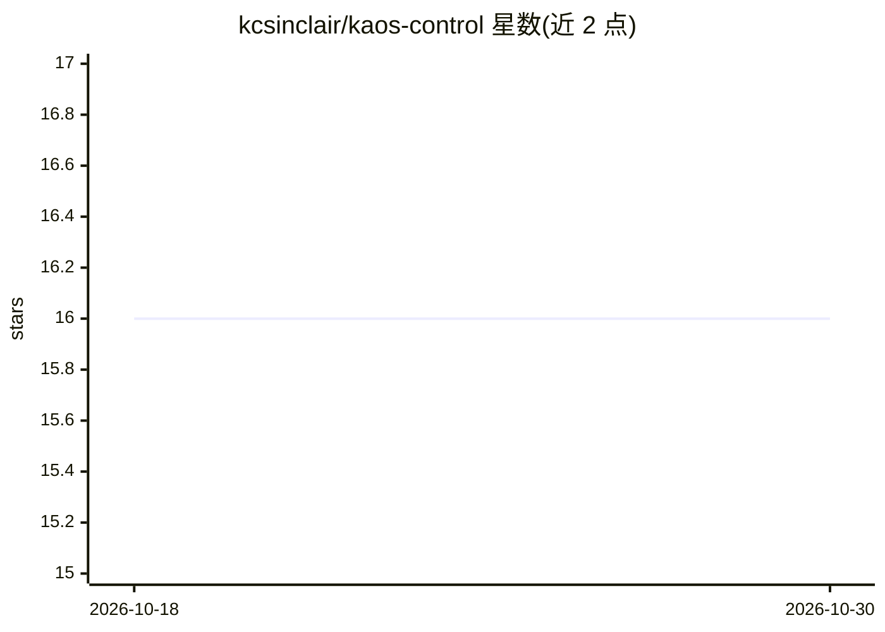

# kcsinclair/kaos-control

⭐ 16 · Go · NOASSERTION · 推送 2026-10-29 · [GitHub](https://github.com/kcsinclair/kaos-control) · [官网](https://kaos-control.io) · 个人维护

**自托管的 Claude Code agent 编排器，按角色门控驱动 SDLC 流程**

面向在真实团队工作流中引入 coding agent 的负责人与开发者：以单个 Go 二进制（内嵌 SPA）自托管运行，将想法转为带 YAML frontmatter 的 markdown 工件，沿 ideas→requirements→plans→tests→releases 生命周期流转并提供血缘追踪。提供两种 Claude 驱动（CLI 直跑与经 PreToolUse 钩子审计的 mediated 模式），可按角色分配模型，支持本地 Ollama agent。限制：v0.1.x，1.0 前可能有破坏性变更；macOS 构建未签名。

## 筛选速览

| 维度 | 判定 | 备注 |
|---|---|---|
| AI 角色 | `ai-ecosystem` | LLM/agent 周边工具 |
| 许可风险 | `none` | NOASSERTION |
| 部署形态 | `desktop` | 安装包/桌面程序 |
| 模型依赖 | local-ok | 支持本地模型 |
| 硬件要求 | — | 无带数字的原话,不猜 |
| 安装摩擦 | `low` | 无编译、无系统依赖或容器化 |
| 成熟度 | `idea` | |

## 能力要点

- 角色门控的工件生命周期状态机与血缘追踪
- mediated 驱动经 PreToolUse 钩子做按 agent 的路径/bash 允许拒绝列表与审计
- 可插拔 agent：claude-code-cli / claude-mediated / ollama / shell-stub
- 单一 Go 二进制（约 250 MB）覆盖 macOS/Linux/Windows，WebSocket 实时运行流

## 适用场景

- 无人值守运行 Claude Code agent 时保留代码审查、测试与发布纪律
- 通过审批文档而非操作 IDE 管控 agent 开发流程
- 让敏感代码走本地 Ollama 模型，避免离开本机

## 场景标签

`编码 Agent` `工作流自动化` · 领域:效率与自动化

## 证据(README 行号)

> L3: > **Self-hosted orchestrator for Claude Code agents.** Drive ideas through a role-gated SDLC — plan → build → test →
> L24: 2. **A mediated Claude driver** that routes every tool call through a `PreToolUse` hook, checked against per-agent 

## 星数曲线

2026-10-18 16 → 2026-10-30 16（+0）

---
*卡片 v1 · prompt 1.4 · 生成 2026-10-30 · 置信度 mid · 依据 README sha `3cfb1ef4cfdd` · [字段定义](../../DATASET.md)*
