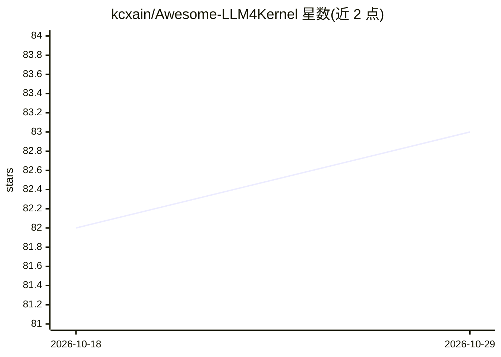

# kcxain/Awesome-LLM4Kernel

⭐ 83 · HTML · 推送 2026-03-31 · [GitHub](https://github.com/kcxain/Awesome-LLM4Kernel) · [官网](https://kechang.xin/Awesome-LLM4Kernel/) · 个人维护

**LLM 辅助 GPU 内核开发领域的论文/基准综述清单**

围绕“用大语言模型支持或自动化 GPU 内核生成、优化与验证”的持续综述清单（自 2025 年 Stanford KernelBench 发布后兴起）。内容分基准与方法两部分：基准收录 SOL-ExecBench、KernelBench、TritonBench 等 15 项评测；方法按搜索式流水线、Agent 流水线、领域专用模型、Agentic RL 四类组织，条目含会议论文、arXiv 预印本、开源项目、技术报告与博客，并附作者、机构与任务形式（如 Torch→CUDA、NL→Triton）。提供在线网页版。

## 筛选速览

| 维度 | 判定 | 备注 |
|---|---|---|
| AI 角色 | `ai-knowledge` | 知识聚合/清单类 |
| 许可风险 | `none` | — |
| 部署形态 | `None` |  |
| 模型依赖 | — | README 未给出锁定关系 |
| 硬件要求 | — | 无带数字的原话,不猜 |
| 安装摩擦 | `medium` | 含编译或系统依赖之一 |
| 成熟度 | — | 结构信号不足 |

## 能力要点

- 覆盖基准与方法两大板块的持续综述
- 方法分四类：搜索式/Agent 流水线/领域专用模型/Agentic RL
- 条目含论文/代码/数据集链接、作者机构与任务形式
- 提供在线网页版

## 适用场景

- 调研 LLM 生成/优化 GPU 内核的已有工作
- 查找该方向的评测基准（KernelBench、TritonBench 等）
- 按机构或方法类别检索相关论文与开源项目

## 场景标签

`精选清单` · 领域:学习与行业

## 证据(README 行号)

> L9: GPU kernels are central to modern compute stacks and directly determine training and inference efficiency. Kernel de
> L11: This project provides a continuous and comprehensive survey of the field, covering both benchmarks and methods. On 

## 星数曲线

2026-10-18 82 → 2026-10-29 83（+1）

---
*卡片 v1 · prompt 1.4 · 生成 2026-10-24 · 置信度 high · 依据 README sha `2836c277ea6f` · [字段定义](../../DATASET.md)*
