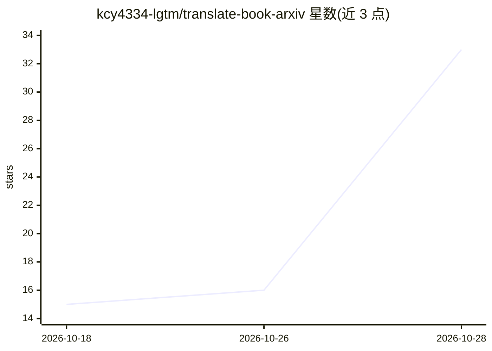

# kcy4334-lgtm/translate-book-arxiv

⭐ 33 · Python · MIT · 推送 2026-10-23 · [GitHub](https://github.com/kcy4334-lgtm/translate-book-arxiv) · 个人维护

**把 arXiv 论文 LaTeX 源码翻译成书籍 PDF 的 agent 技能**

面向 Claude Code、Codex 与 OpenClaw 的 agent 技能：识别 arXiv 预印本后下载其 LaTeX 源码，按块分派 8 个并行子代理翻译，保留公式、图表与论文自身编号，经 chunk 校验、术语表一致性检查与 SHA-256 清单断点续跑后，经 Pandoc 与无头 Chromium 输出 HTML/DOCX/EPUB/PDF。支持 zh/en/ja/ko/fr/de 等目标语言，排版以韩文调校。附带宏展开、来源核对脚本与四个知识库及顾问子代理。需 Python 3.8+、Pandoc、Chromium 系浏览器，EPUB 输出需 Calibre。

## 筛选速览

| 维度 | 判定 | 备注 |
|---|---|---|
| AI 角色 | `ai-native` | 本体是模型或模型工具 |
| 许可风险 | `permissive` | MIT |
| 部署形态 | `library` | 以包/库形式分发 |
| 模型依赖 | — | README 未给出锁定关系 |
| 硬件要求 | — | 无带数字的原话,不猜 |
| 安装摩擦 | `low` | 无编译、无系统依赖或容器化 |
| 成熟度 | — | 结构信号不足 |

## 能力要点

- 读取 LaTeX 源码翻译，公式与论文自身编号保留并由 tests/source_probe.py 对照原 PDF 校验
- 8 个并行子代理分块翻译，每块独立上下文，chunk 级校验后合并
- 展开论文自带宏（scripts/paper_macros.py），参考文献原样复制
- 无头 Chromium 按真实 @page 盒打印印刷级 PDF，另出 HTML/DOCX/EPUB

## 适用场景

- 把 arXiv 论文翻译成可打印的韩文/日文/中文等语言书籍
- 在保留公式与编号的前提下整本翻译长论文
- 对 PDF/DOCX/EPUB 书籍做整本翻译

## 场景标签

`科研工具` · 领域:学习与行业

## 证据(README 行号)

> L3: An agent skill for Claude Code, Codex and OpenClaw that turns an arXiv paper into a translated, printable book. It r
> L52: - **Parallel sub-agents**: 8 translators at a time, each with its own context, in foreground batches so the skill's
> L57: - **Output**: HTML with a floating TOC, DOCX, EPUB and PDF, with an optional EPUB cover, working folder and export 

## 星数曲线

2026-10-18 15 → 2026-10-28 33（+18）

---
*卡片 v1 · prompt 1.4 · 生成 2026-10-28 · 置信度 mid · 依据 README sha `c820bcd52e4e` · [字段定义](../../DATASET.md)*
