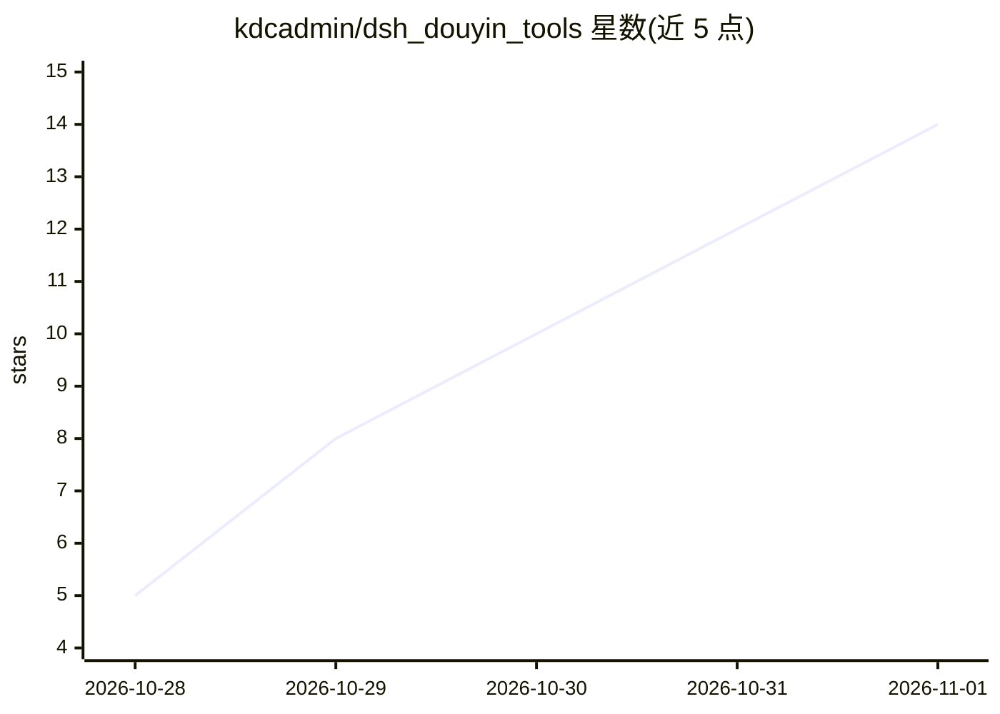

# kdcadmin/dsh_douyin_tools

⭐ 14 · JavaScript · MIT · 推送 2026-10-30 · [GitHub](https://github.com/kdcadmin/dsh_douyin_tools) · 个人维护 · 中文 README

**DSH 插件：让 AI agent 替用户刷抖音并做互动**

面向 DSH 宿主的抖音自动化插件：每天按谷时窗口刷推荐流，用 faster-whisper 转写视频音频（ffmpeg 转 16kHz PCM，watchSeconds 预算截断），读评论，挑选视频写日报，并执行点赞、评论（可 @ 指定人）、转发、续火花、回私信等互动动作（各写动作默认关闭，设闸门与每日额度）。默认模型配置为 deepseek-account/deepseek-flash。自带记忆/人设文件与 35 个 dy_* 工具，通过 Playwright 驱动本机 Chrome，插件内含 Python MCP。安装方式为 dsh plugin add link 源码目录，npm 上未发布。

## 筛选速览

| 维度 | 判定 | 备注 |
|---|---|---|
| AI 角色 | `ai-ecosystem` | LLM/agent 周边工具 |
| 许可风险 | `permissive` | MIT |
| 部署形态 | `desktop` | 安装包/桌面程序 |
| 模型依赖 | locked-api |  |
| 硬件要求 | — | 无带数字的原话,不猜 |
| 安装摩擦 | `medium` | 含编译或系统依赖之一 |
| 成熟度 | `idea` | |

## 能力要点

- 35 个 dy_* 工具覆盖刷流、转写、评论、私信、发布等操作
- faster-whisper 转写 + ffmpeg 音轨处理，watchSeconds 取样预算与 partial 标记
- 所有写动作默认关闭，经闸门与每日额度控制，回执未确认记 unknown 不自动重发
- 自带记忆/人设机制（memory/YYYY-MM.md + persona.md），不依赖其他记忆插件

## 适用场景

- 让 agent 定时替我刷抖音、看片并生成日报
- 自动回复我视频下的新评论和白名单私信
- 把本地渲染好的成片以草稿形式发到抖音

## 场景标签

`浏览器自动化` · 领域:效率与自动化

## 证据(README 行号)

> L5: > DSH 插件。每天替使用者刷抖音：**刷推荐流 → 看片（转写）→ 读评论 → 挑片写日报**，
> L11: **装法**：从插件市场 / npm 装，或把源码目录 link 进 profile。设置页有「刷抖音」一页（**日常 / 刷视频 / 互动 / 私信 / 表情包 / 高级** 六个 tab），左侧还有「记忆」页（**插件自带**
> L19: 1. **装 Python 依赖（MCP）** —— 插件自带 Python MCP，依赖在 `vendor/douyin-mcp/requirements.txt`（`mcp<2`、`playwright`、`faster-wh

## 星数曲线

2026-10-28 5 → 2026-11-01 14（+9）

---
*卡片 v1 · prompt 1.4 · 生成 2026-10-31 · 置信度 mid · 依据 README sha `8a951771c9fa` · [字段定义](../../DATASET.md)*
