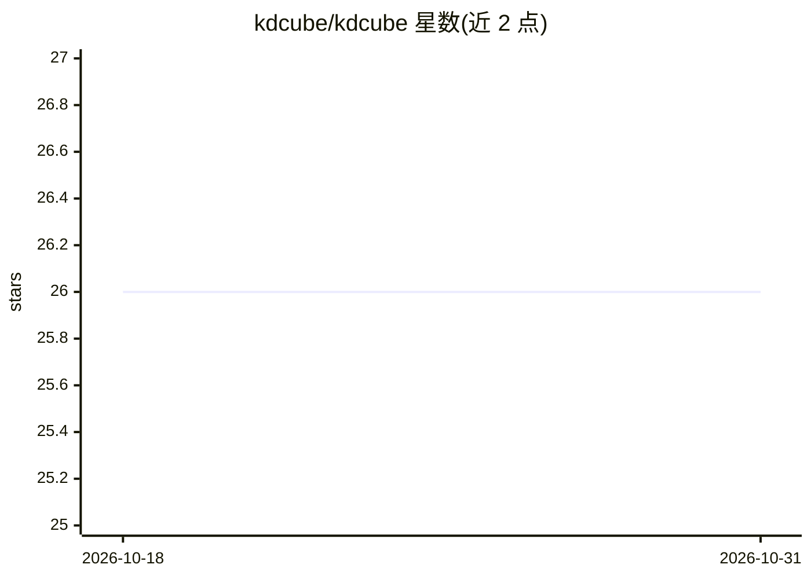

# kdcube/kdcube

⭐ 26 · Python · MIT · 推送 2026-10-30 · [GitHub](https://github.com/kdcube/kdcube) · [官网](https://kdcube.tech) · 组织维护

**自托管 AI 应用服务器与 SDK：多用户托管运行 agent**

面向 AI 应用与 agent 的自托管应用服务器与生产运行时：以租户/项目为单位部署，加载声明式应用描述符，对外提供 agent、REST、MCP 端点、widget、网站、事件与任务等服务面。开发者可保留 LangGraph、CrewAI、Claude Agent SDK、Claude Code 或自有 agent 逻辑，通过适配器接入共享 Harness 运行时；平台侧提供身份、有序投递、存储、密钥管理、预算控制、生成代码隔离与运行时策略执行。内置 Connection Hub 管理对外部 MCP 的可撤销委托访问。经 pip 安装 CLI，以本地 Docker Compose 启动。

## 筛选速览

| 维度 | 判定 | 备注 |
|---|---|---|
| AI 角色 | `ai-ecosystem` | LLM/agent 周边工具 |
| 许可风险 | `permissive` | MIT |
| 部署形态 | `library` | 以包/库形式分发 |
| 模型依赖 | — | README 未给出锁定关系 |
| 硬件要求 | — | 无带数字的原话,不猜 |
| 安装摩擦 | `low` | 无编译、无系统依赖或容器化 |
| 成熟度 | — | 结构信号不足 |

## 能力要点

- 租户/项目部署内多用户、多应用共享运行时服务
- 通过适配器托管 LangGraph / CrewAI / Claude Agent SDK / Claude Code 等既有 agent
- 生成代码隔离执行（子进程/合并 Docker/分离 Docker 三档 profile）
- Connection Hub 提供外部 MCP 的按调用方画像授权与可撤销委托访问

## 适用场景

- 把已有的 LangGraph 或 Claude Code agent 部署为多用户生产服务
- 为 agent 提供预算、密钥与生成代码隔离等运行时治理
- 以可撤销的调用方画像向 agent 或 MCP 客户端开放受控工具

## 场景标签

`Agent 框架` · 领域:Agent 开发

## 证据(README 行号)

> L5: **The open-source, self-hosted application server and production runtime for AI applications and agents.**
> L20: Keep the agent and product code you already have. Run LangGraph, CrewAI,
> L58: KDCube is an application runtime and SDK, not a single MCP server or a

## 星数曲线

2026-10-18 26 → 2026-10-31 26（+0）

---
*卡片 v1 · prompt 1.4 · 生成 2026-10-27 · 置信度 high · 依据 README sha `7fce8712aa37` · [字段定义](../../DATASET.md)*
