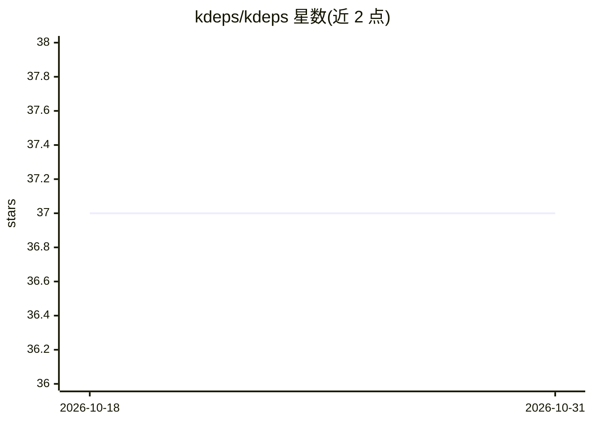

# kdeps/kdeps

⭐ 37 · Go · Apache-2.0 · 推送 2026-10-30 · [GitHub](https://github.com/kdeps/kdeps) · [官网](https://kdeps.com) · 组织维护

**用 YAML 定义 AI 工作流与 Agent 的 Git 原生构建工具**

面向开发者的 AI 应用构建工具：以 Git 仓库中的 YAML 文件定义工作流、AI agent、agent 团队（agencies）与 AI API，任务可依赖排序、内置测试命令与进程内路由测试。支持本地推理服务器（OpenAI 兼容后端）或托管 AI 服务，可将同一项目打包为 Docker 镜像、Kubernetes 清单、可启动 ISO 或独立二进制。CLI 外另提供带聊天界面的桌面应用，通过 brew、安装脚本或 PowerShell 安装，采用 Apache 2.0 许可。

## 筛选速览

| 维度 | 判定 | 备注 |
|---|---|---|
| AI 角色 | `ai-ecosystem` | LLM/agent 周边工具 |
| 许可风险 | `permissive` | Apache-2.0 |
| 部署形态 | `None` |  |
| 模型依赖 | — | README 未给出锁定关系 |
| 硬件要求 | — | 无带数字的原话,不猜 |
| 安装摩擦 | `low` | 无编译、无系统依赖或容器化 |
| 成熟度 | — | 结构信号不足 |

## 能力要点

- YAML 定义工作流/agent/agencies/AI API，以 Git 为单一事实来源
- 多部署目标：Docker 镜像、Kubernetes 清单、启动 ISO、独立二进制
- kdeps llm 命令与向导配置本地或自管推理服务器（OpenAI 兼容后端）
- 无需 Go 代码即可通过 YAML 添加 http/exec/sql/python 工具与斜杠命令

## 适用场景

- 在 Git 中版本化定义并审阅 AI 工作流与 agent 配置
- 把同一份 AI 项目从本地开发打包到 Docker/K8s/ISO 部署
- 连接多个专用 agent 组成协作团队
- 在内网自管推理服务器上运行 AI 服务以控制数据边界

## 场景标签

`工作流自动化` `Agent 框架` `多智能体` · 领域:Agent 开发

## 证据(README 行号)

> L16: Define your AI agent in YAML. Build it once. Run it where you need it.
> L18: Kdeps helps you build AI workflows, agents, and AI services using YAML files stored in your Git repository.
> L73: |`kdeps llm`|Helps set up a standalone AI inference server.|

## 星数曲线

2026-10-18 37 → 2026-10-31 37（+0）

---
*卡片 v1 · prompt 1.4 · 生成 2026-10-25 · 置信度 high · 依据 README sha `32c22258d1c9` · [字段定义](../../DATASET.md)*
