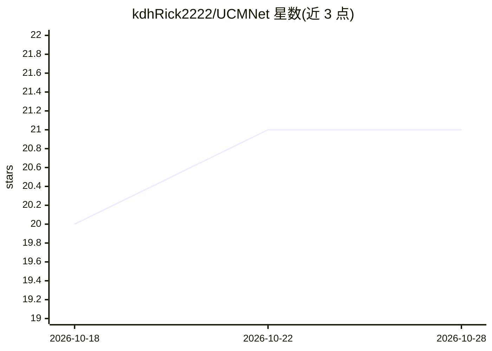

# kdhRick2222/UCMNet

⭐ 22 · Python · 推送 2026-08-18 · [GitHub](https://github.com/kdhRick2222/UCMNet) · [官网](https://kdhrick2222.github.io/projects/UCMNet/) · 组织维护

**屏下摄像头图像修复模型官方实现（CVPR'26）**

汉阳大学团队的 CVPR'26 论文官方代码：提出轻量级不确定性感知上下文记忆网络 UCMNet，针对屏下摄像头（UDC）成像退化进行图像修复，对不同退化程度区域做自适应处理以恢复高频细节。提供 POLED/TOLED/SYNTH 三个数据集的预训练权重，支持通过 pip 安装依赖后运行 testing_n_saving.py 评估与 training_n_recording.py 训练；实验设置沿用 BNUDC、FSI 等先前工作。

## 筛选速览

| 维度 | 判定 | 备注 |
|---|---|---|
| AI 角色 | `ai-native` | 本体是模型或模型工具 |
| 许可风险 | `none` | — |
| 部署形态 | `library` | 以包/库形式分发 |
| 模型依赖 | — | README 未给出锁定关系 |
| 硬件要求 | — | 无带数字的原话,不猜 |
| 安装摩擦 | `low` | 无编译、无系统依赖或容器化 |
| 成熟度 | — | 结构信号不足 |

## 能力要点

- 不确定性感知的自适应修复，处理不同退化区域
- 提供 POLED/TOLED/SYNTH 三个数据集预训练权重
- 包含评估与训练脚本

## 适用场景

- 研究者在 POLED/TOLED/SYNTH 数据集上复现 UDC 修复结果
- 作为 UDC 图像修复方法的基线进行对比实验
- 基于代码继续训练或改进模型

## 场景标签

`图像视频处理` · 领域:感知与多模态

## 证据(README 行号)

> L23: > We propose a lightweight Uncertainty-aware Context-Memory Network (UCMNet), for UDC image restoration. Unlike pre
> L2: for Under-Display Camera Image Restoration (CVPR'26)

## 星数曲线

2026-10-18 20 → 2026-10-28 21（+1）

---
*卡片 v1 · prompt 1.4 · 生成 2026-10-28 · 置信度 high · 依据 README sha `955ac00c4346` · [字段定义](../../DATASET.md)*
